# Measuring distance one photon at a time

Can a neural network design a circuit that measures distance from single photons
without storing a histogram? This project searches for circuit using real
single-photon sensor data to find task-driven insights from it.

The chosen circuit keeps **18 bits of memory per pixel** instead of a histogram
of about **8,000 bits**. It measures distance to within **34 cm on 76% of
pixels**, and its layout fits in a **10.5 µm square** in a predictive 7 nm
process.

This overview follows the project's explainer video. The pictures are frames
from that video, drawn from the chosen circuit's real data.

## 1. The problem

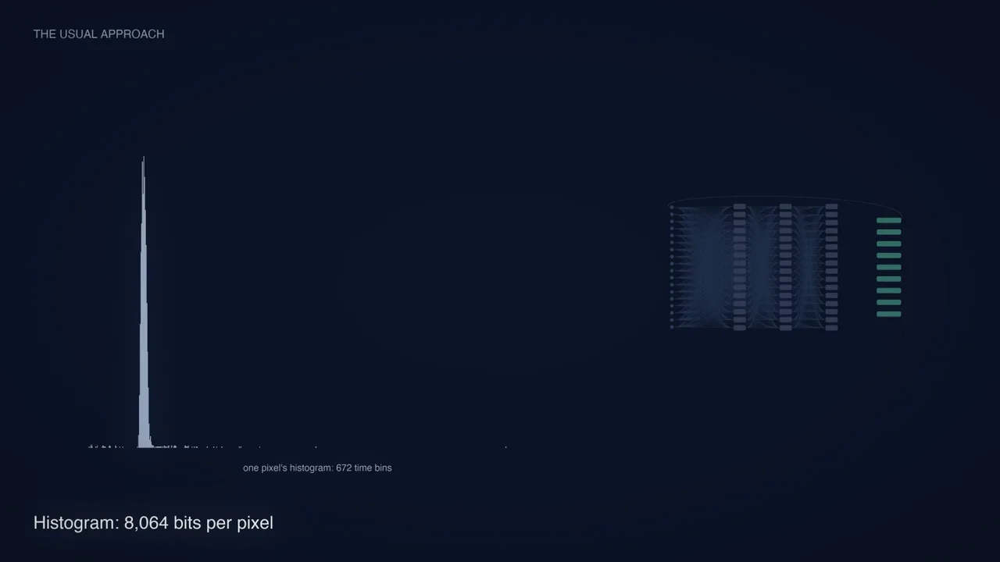

A lidar sensor measures distance with light. It sends out a short laser pulse
and times how long individual photons take to come back. Many lidar sensors use
**single-photon avalanche diodes (SPADs)**, detectors sensitive enough to record
when each photon arrives. Each time step is 750 ps, which is 11.2 cm of
distance, and there are 672 steps, about 75 m in total.

One photon on its own is not enough: many come from sunlight or room light and
arrive at random times. The usual approach is to count photons into a
**histogram**, one bin for each possible arrival time, and pick the tallest bin.
That takes about 8,064 bits of memory for every pixel, and across a sensor with
thousands of pixels that memory takes up much of the chip.

This project asks whether a tiny circuit under each pixel can keep a single
running distance guess instead, updating it every time a photon arrives. It
also asks whether a computer can design that circuit from examples of right
answers.

The examples come from
**[SP-TransientBench](https://huggingface.co/datasets/shuinb/SP-TransientBench)**,
a public set of real SPAD recordings of indoor and outdoor scenes, each pixel
with its recorded photon histogram and a reference distance. Whole recordings
are split into training, design, validation and held-out test sets, so the
circuit is never scored on a scene it learned from.

## 2. The circuit

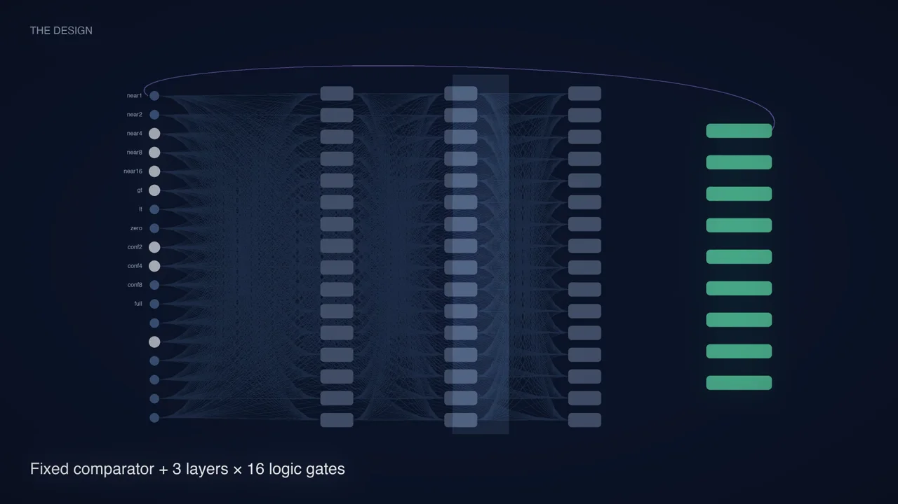

Each pixel has its own copy of the circuit, in two parts:

- **A fixed comparator** compares each photon with the current guess and turns
  it into yes/no flags. Is it within 1, 2, 4, 8 or 16 steps of the guess? Is it
  earlier or later? Is the confidence count zero, at least 2, 4 or 8, or full?
- **Three layers of 16 logic gates** read those flags, plus 4 memory bits, and
  decide what each photon does: replace the guess, move it one step later or
  earlier, raise or lower the confidence, and update the memory bits.

The memory (a 10-bit guess, a 4-bit confidence count and the 4 memory bits) and
the comparator are designed by hand. The gates, the part that decides how the
circuit behaves, are what training finds.

## 3. How it was trained

Training has two phases.

### Phase 1: gradient training (DARTS), 1,500 steps

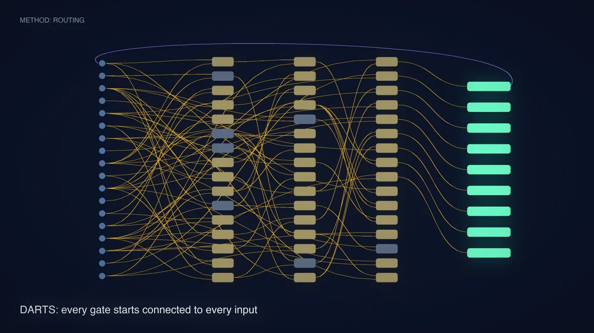

At first every gate is partly connected to every wire it could read, as in the
[full adder](../basics/full-adder-discovery/README.md) experiment. Each gradient
step nudges those connections toward whatever lowers the distance error, until
each gate settles on two inputs. Gate functions learn on the training
recordings; the wiring learns on a separate design recording.

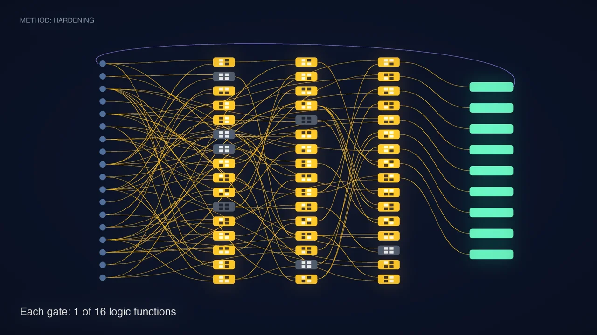

At the same time each gate starts as a blend of all 16 possible two-input logic
functions. As training goes on, a falling temperature pushes it to commit to
one, which turns the network into an ordinary circuit of real gates. From 30% of
the way through (step 450), the forward pass uses the committed gates outright
while gradients still flow to the blends.

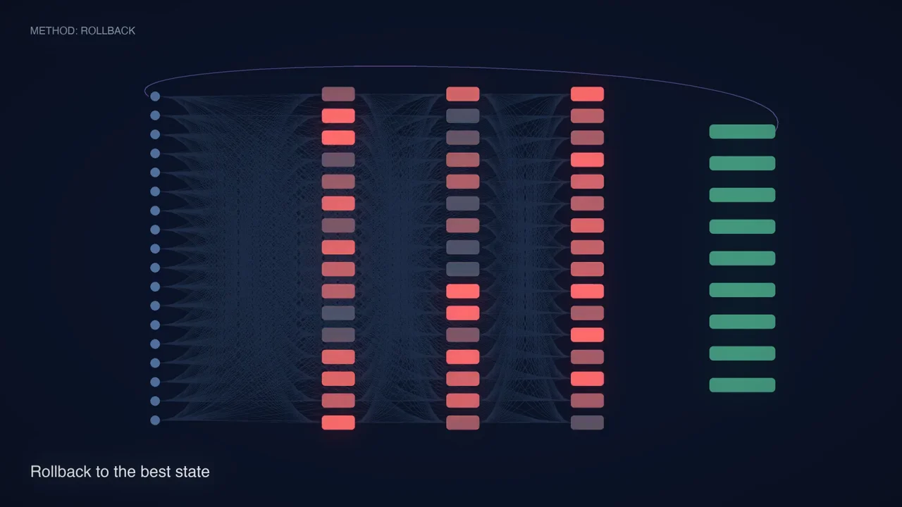

Sometimes committing makes the error suddenly much worse. When the error rises
above 1.25× the best so far, training goes back to the best version. This
happened once in the chosen run.

During training only, a "physics check" penalizes distances that the photons do
not support, without looking at the correct answers. It is not part of the
chip.

### Phase 2: exact search, 1,500 generations

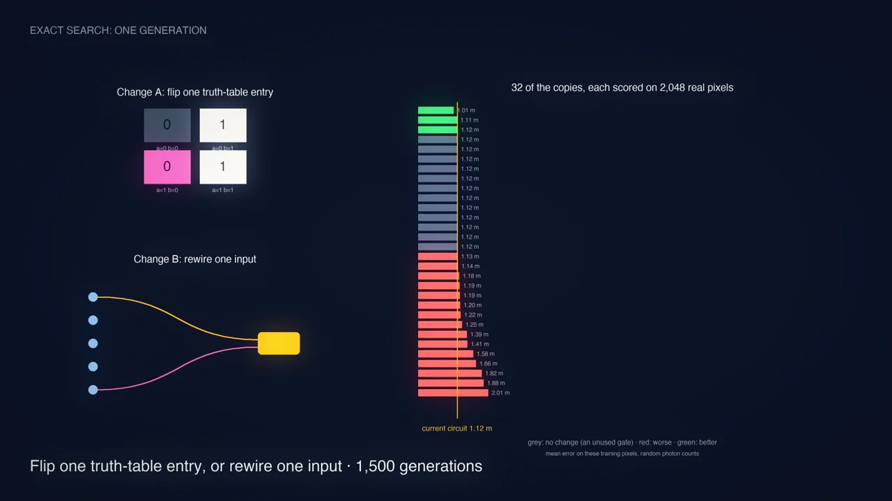

Gradient training only sees a smoothed version of the circuit, so the second
phase works on the exact circuit. Each generation makes 512 copies of the
current best circuit and gives each one or two small random changes: flip one
entry of a gate's truth table, or rewire one gate input. Each copy is scored on
2,048 real pixels, and the best one replaces the current circuit if it is at
least as good. In the generation shown, about half the changes made things
worse (red) and about a third hit unused gates and changed nothing (grey). The
few that looked better (green) might only be better on that sample of pixels.
That is why the final choice is made on separate validation pixels.

### Accuracy during training

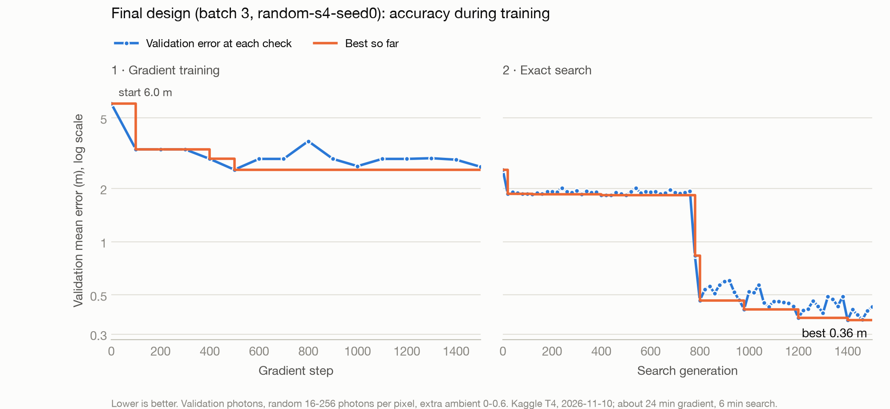

The chart tracks the chosen circuit's validation mean error through both
phases, on a log scale, always scoring the exact (hardened) circuit. Gradient
training brings it from 6.0 m to 2.55 m. The search then holds at about 1.9 m
until around generation 780, finds a change that drops it below 0.5 m, and
keeps refining to 0.36 m. Blue is the error at each check; orange is the best
so far, which is the circuit that is kept. The search did most of the work.

**Why steps and generations instead of epochs.** An epoch means one full pass
through a fixed training set, and this training has neither a fixed set nor a
single kind of update:

- **The examples are new every time.** Each gradient step picks 1,024 training
  pixels at random and replays a fresh photon stream from each pixel's recorded
  histogram, with a random photon count (16 to 256) and a random amount of extra
  background light. The same pixel never gives the same example twice, so there
  is no point at which the data has been "seen once", and no epoch to count.
- **The two phases do different kinds of work.** A gradient step updates the
  soft connections and gate blends. A search generation makes no gradient update
  at all: it tries 512 changed copies of the exact circuit and keeps the best.
  Neither maps onto an epoch, and their counts are not comparable with each
  other, so each phase gets its own axis.
- **These are the units the run is set and measured in.** The run is configured
  as 1,500 gradient steps and 1,500 generations, and it checks validation error
  every 100 steps and every 20 generations. Those checks are the points on the
  chart.

## 4. Why this circuit was chosen

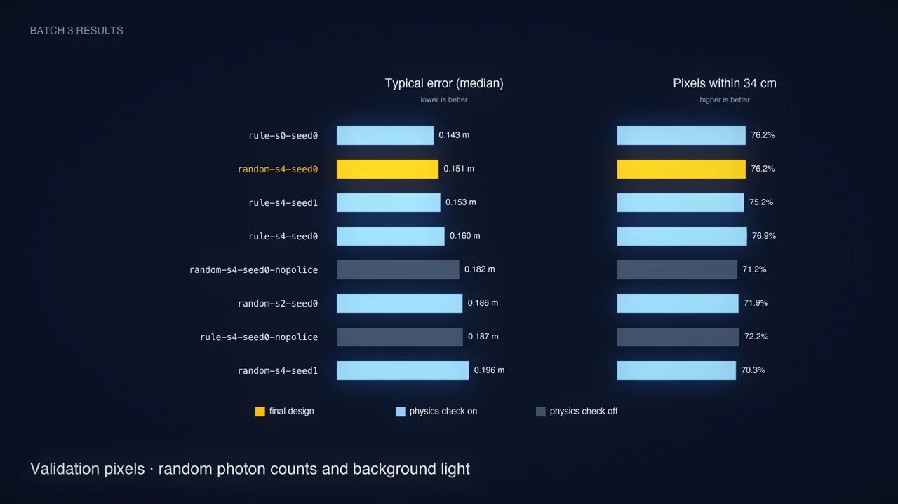

The third batch of training ran eight jobs on a Kaggle T4, about 30 minutes
each. Some started from a hand-designed rule and some from random gates, with
0, 2 or 4 memory bits. All eight produced working circuits, scored here on the
same validation pixels. The chosen one (highlighted) started from random gates
with 4 memory bits. It reads a typical pixel to within 15 cm, and 76% of its
pixels land within 34 cm of the reference distance.

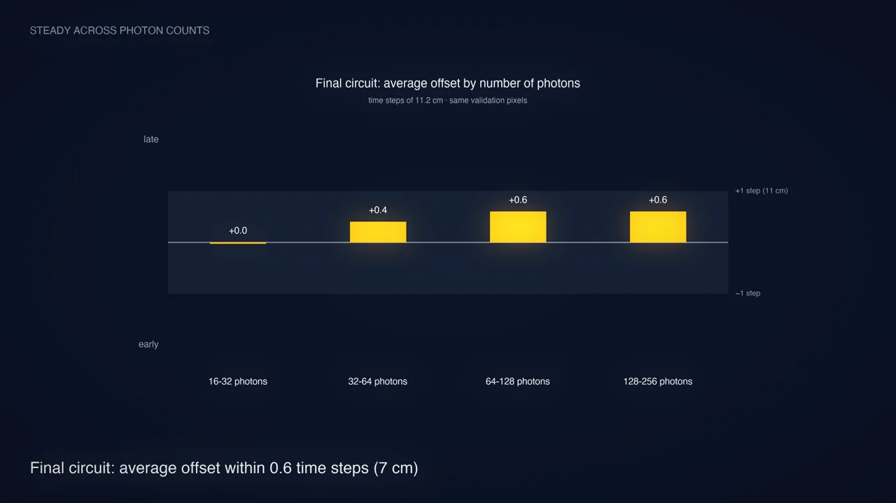

The main reason for choosing it is how steady it is. Its average offset stays
within 0.6 time steps (7 cm) from 16 photons to 256, so it does not read late in
the dark and early in bright light.

Compared on the same validation photons with the alternatives:

| | Learned circuit | Hand-written rule (same hardware) | Histogram, tallest bar |
|---|---|---|---|
| Average error | **0.363 m** | 2.25 m | 0.354 m |
| Median error | **0.151 m** | 0.189 m | 0.184 m |
| Within 34 cm (3 steps) | **76.2%** | 70.0% | 71.6% |
| Memory per pixel | 18 bits | 14 bits | about 8,064 bits |

The learned circuit matches the histogram method on average error and beats it
on median error, while storing about 450 times less. A smoother histogram
method (an 8-step box filter) does better still, with 79.7% of pixels within
34 cm, but it also needs the full histogram.

Two simple tests catch circuits that only look good:

- A circuit that ignores the photons and always answers the most typical
  distance has an average error of **1.97 m**. A useful circuit must beat that.
- If every photon is delayed by 24 steps, the answer must move by exactly 24
  steps. The chosen circuit passes on 100% of pixels.

## 5. What it learned

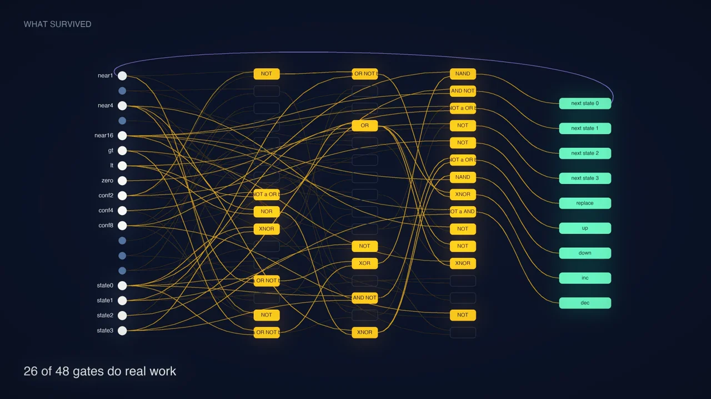

Of the 48 gates, 26 do real work, together with the 4 memory bits. The rest are
constants or unused, and synthesis removes them.

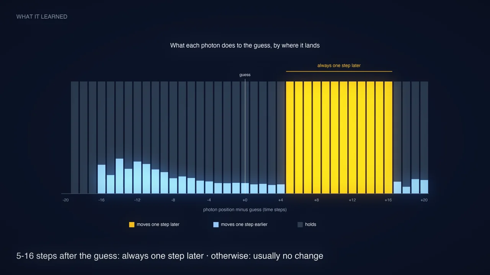

The rule it learned is simple. A photon 5 to 16 steps after the guess always
moves it one step later. Any other photon usually leaves it alone, and about one
time in ten moves it one step earlier, depending on the memory bits. Photons
more than 16 steps away are ignored as background light.

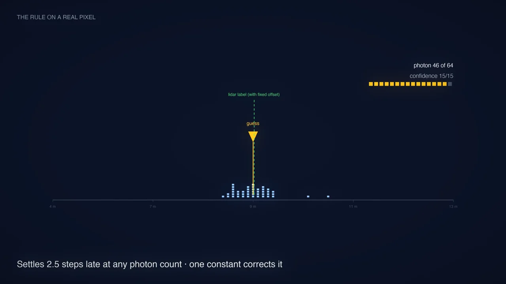

On a real pixel, the strong pull later and the weak pull earlier balance out on
the returning pulse, about 2.5 steps after the true surface. That balance point
does not change with the number of photons, so one fixed constant corrects it.

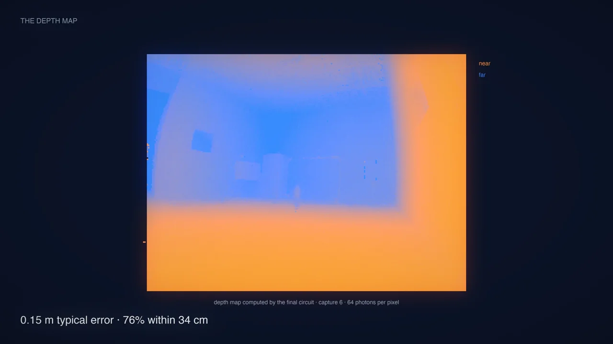

Running the circuit on every pixel of a real capture (capture 6, 64 photons per
pixel) gives this depth map.

Some other things the results show:

- **About 64 photons are enough.** Accuracy at 64 photons (0.286 m average
  error) is nearly the same as at 256 (0.280 m). Twenty-four photons already
  put 70% of pixels within 34 cm.
- **It can be made smaller.** Rerunning the search with chip area as the goal
  found a version 8% smaller (24.68 µm², 253 cells, 17 memory bits) with the
  same accuracy. It is in [`circuits/area-optimized/`](circuits/area-optimized/).

## 6. From circuit to chip layout

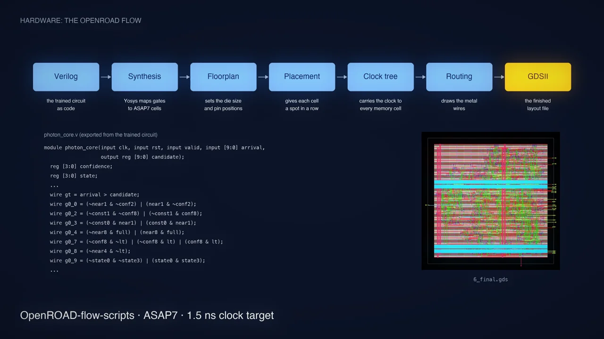

The chosen circuit was turned into a real layout with
**[OpenROAD-flow-scripts](https://github.com/The-OpenROAD-Project/OpenROAD-flow-scripts)**,
an open-source tool chain that takes a circuit description through every step
of physical chip design: converting it into standard cells, placing those cells,
building the clock network, routing the wires and checking the result. The cells
come from **ASAP7**, a predictive 7 nm teaching library.

| Result | Chosen circuit |
|---|---|
| Timing | Met at a 1.5 ns clock, with 609 ps to spare |
| Fastest clock after routing | 682 ps, about 1.47 GHz |
| Hold margin | 42 ps |
| Clock skew | 2.6 ps |
| Die | 110 µm² (about 10.5 × 10.5 µm) |
| Cells | 451, using 44.1 µm² (49% of the core) |
| Wire length | 916 µm |
| Design-rule errors after routing | 0 |
| Power | 71 µW, assuming the circuit switches on every clock |

The layout uses more cell area than the logic alone (26.8 µm²) because the flow
adds supporting cells for the clock, power connections and timing.

The pictures below were produced by the flow itself.

| Finished layout | Cell placement |
|---|---|
| 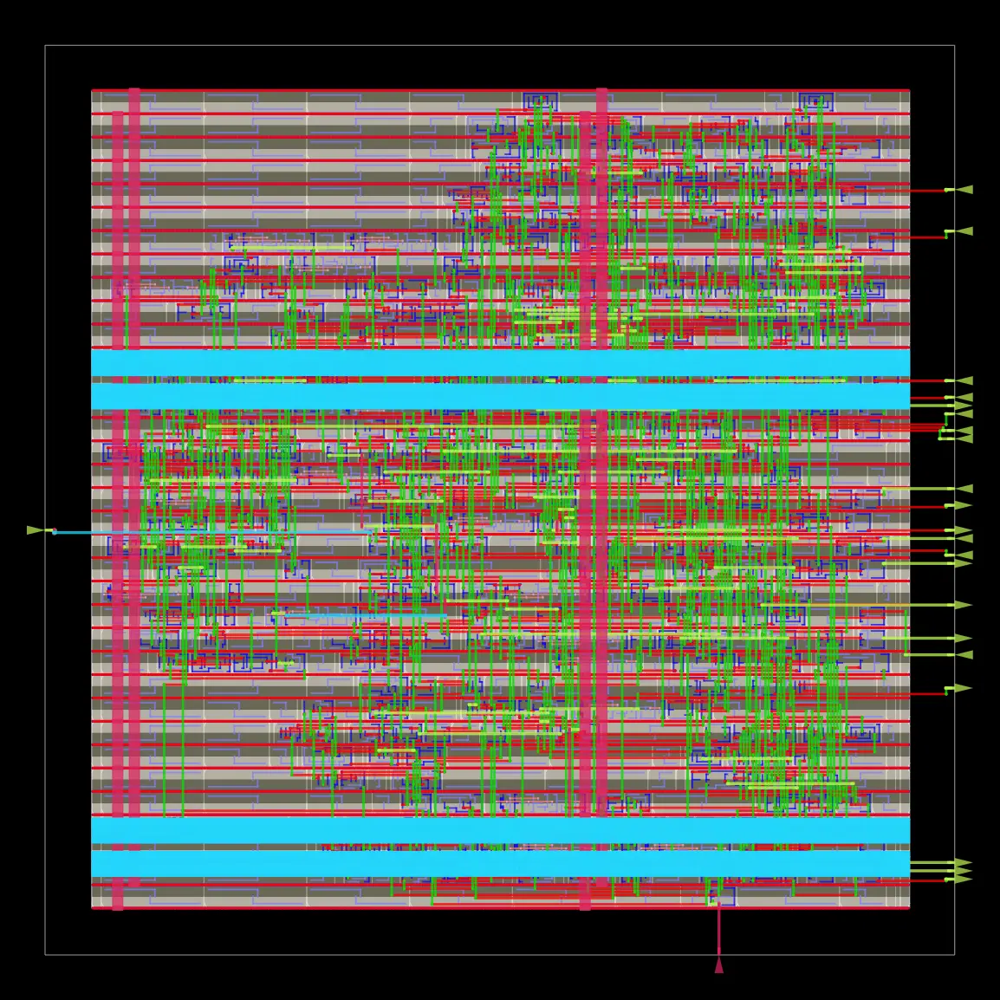 | 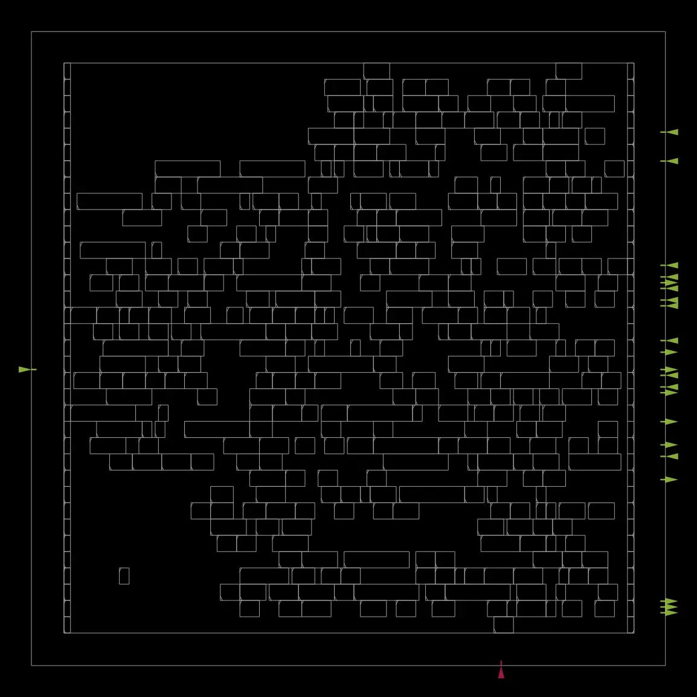 |

| Wire routing | Slowest signal path |
|---|---|
| 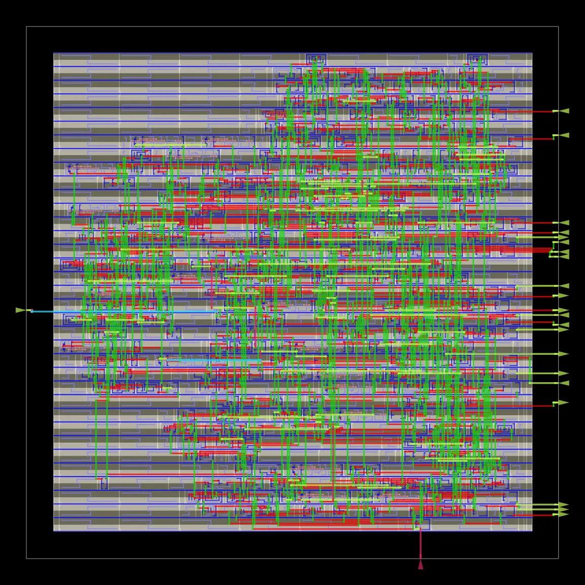 | 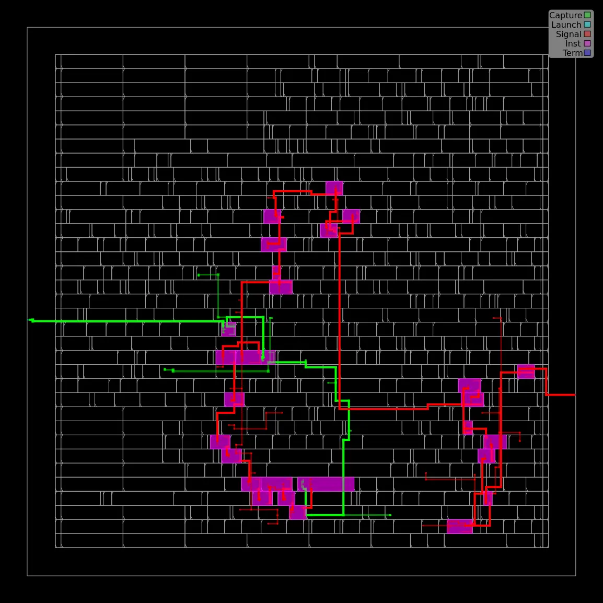 |

| Clock network | Routing congestion |
|---|---|
| 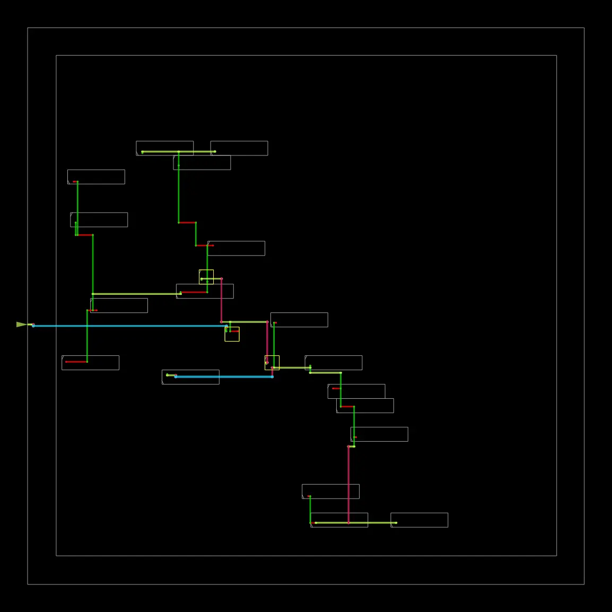 | 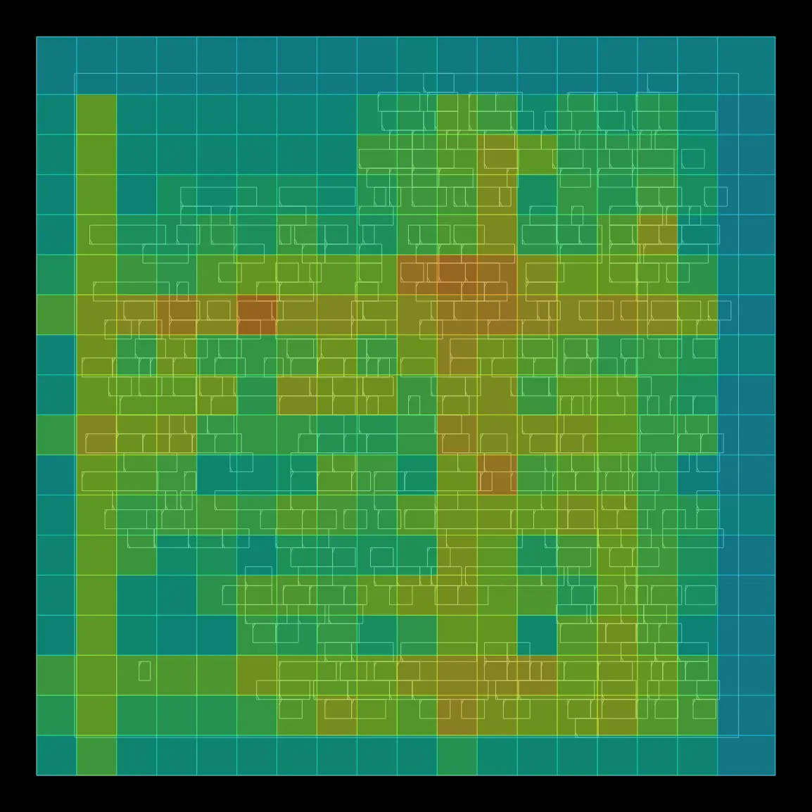 |

The slowest signal path sets the fastest clock: a signal needs 682 ps to travel
from one memory bit, through the comparator and controller, to the next memory
bit. The layout file, routed circuit and full timing report are in
[`asic/results/2026-11-10_final_batch3-random-s4-seed0_asap7_1500ps/`](asic/results/2026-11-10_final_batch3-random-s4-seed0_asap7_1500ps/README.md).

**Every gate in the layout:** [`gates.svg`](asic/results/2026-11-10_final_batch3-random-s4-seed0_asap7_1500ps/gates.svg) draws all 381
logic cells of the routed circuit with logic-gate symbols. Compound cells such
as OA21, AOI221 and the half and full adders are drawn as their internal gates
inside a dashed outline. The image is large, so open it and zoom in.

## Limitations

- **This is an exploration, not a chip ready to make.** ASAP7 is a predictive
  library that cannot be manufactured. The area and speed numbers are realistic
  estimates.
- **The final test has not been run.** All accuracy numbers come from
  validation recordings. The held-out recordings are saved for one final check.
- **Many results come from a single run.** Training includes randomness, and
  different random starts reach circuits between 22.8 and 26.8 µm² with the same
  settings.
- **Sensor effects are modelled, not measured.** In a pile-up model (several
  photons competing in one laser pulse), the chosen circuit's answer shifts by
  3.8 steps, just over the proposed limit of 3. The area-optimized version
  shifts by 2.8.
- **The power figure is pessimistic.** It assumes the circuit switches on every
  clock, while real photons arrive far less often.
- **The dataset is not included.** SP-TransientBench is licensed CC BY-NC-SA
  4.0. The download script fetches it (about 2.2 GB after preparation).

## What's in this folder

| Folder or file | Purpose |
|---|---|
| [`spad/dataset/`](spad/dataset/) | Downloads SP-TransientBench, prepares the photon data and reference distances |
| [`spad/core/`](spad/core/) | The circuit model and its exact simulators |
| [`spad/training/`](spad/training/) | The search, the physics check and the comparison methods |
| [`spad/hardware/`](spad/hardware/) | Verilog export, ASAP7 synthesis, timing and the area estimate |
| [`circuits/`](circuits/) | The chosen circuit and its area-optimized version, as `circuit.json` and Verilog |
| [`asic/`](asic/README.md) | OpenROAD flow inputs, the run script and the routed layout |

## Running it

You need Python with the packages in [`requirements.txt`](requirements.txt).
Run everything from this `SPAD/` folder:

```bash
python -m spad.dataset.download      # fetch SP-TransientBench
python -m spad.dataset.prepare       # prepare the photon data
python -m spad.hardware.costs        # read ASAP7 cell sizes and delays
python -m spad.dataset.calibration   # refine the reference distances
python -m spad.dataset.scenes        # add the larger scenes
```

To train and shrink a circuit, then check its real area:

```bash
python -m spad.training.train_stream --help
python -m spad.training.train_stream --objective area --init circuit \
  --init-circuit circuits/final/circuit.json --steps 0 --out runs/my-area-run
python -m spad.hardware.synth runs/my-area-run/circuit.json
```

The chip layout needs Docker. [`asic/README.md`](asic/README.md) explains how to
lay out a circuit with `asic/run_flow.sh`.
