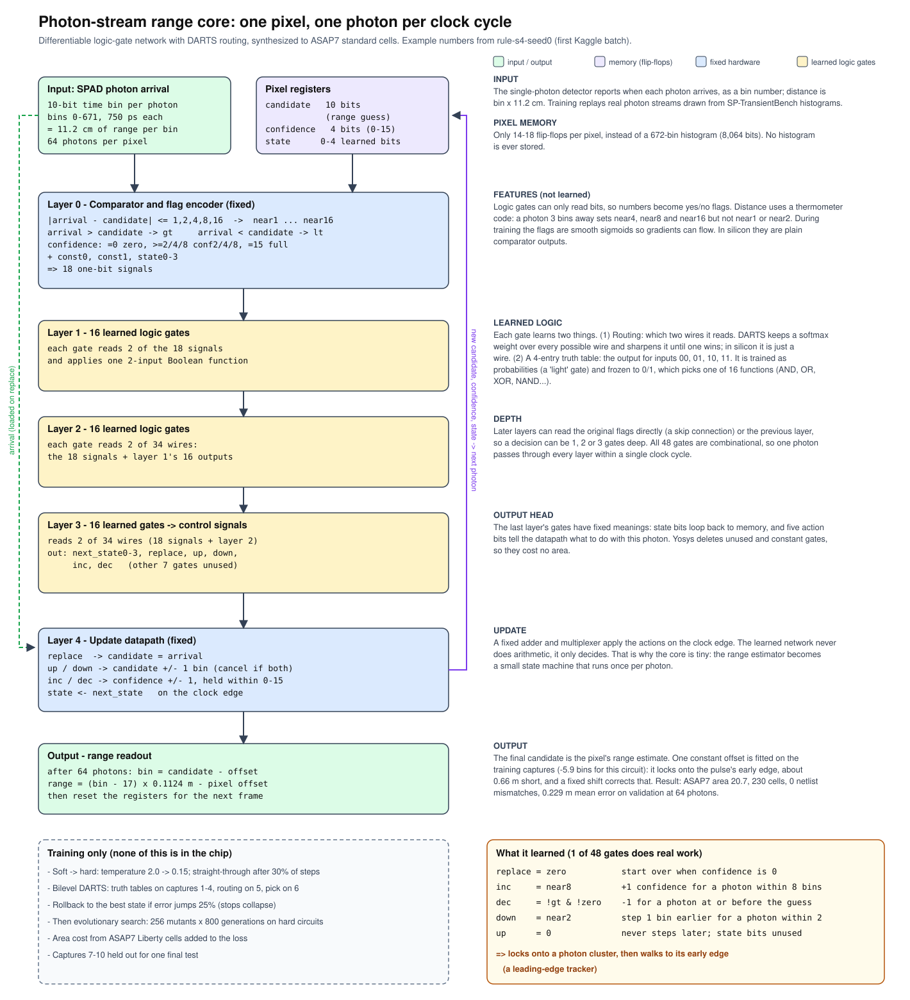
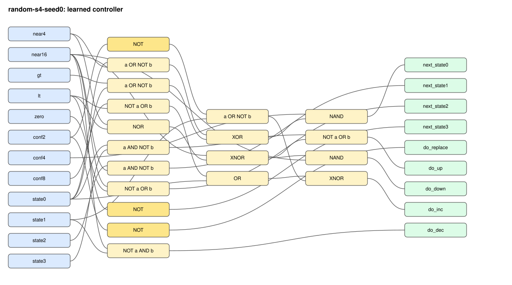
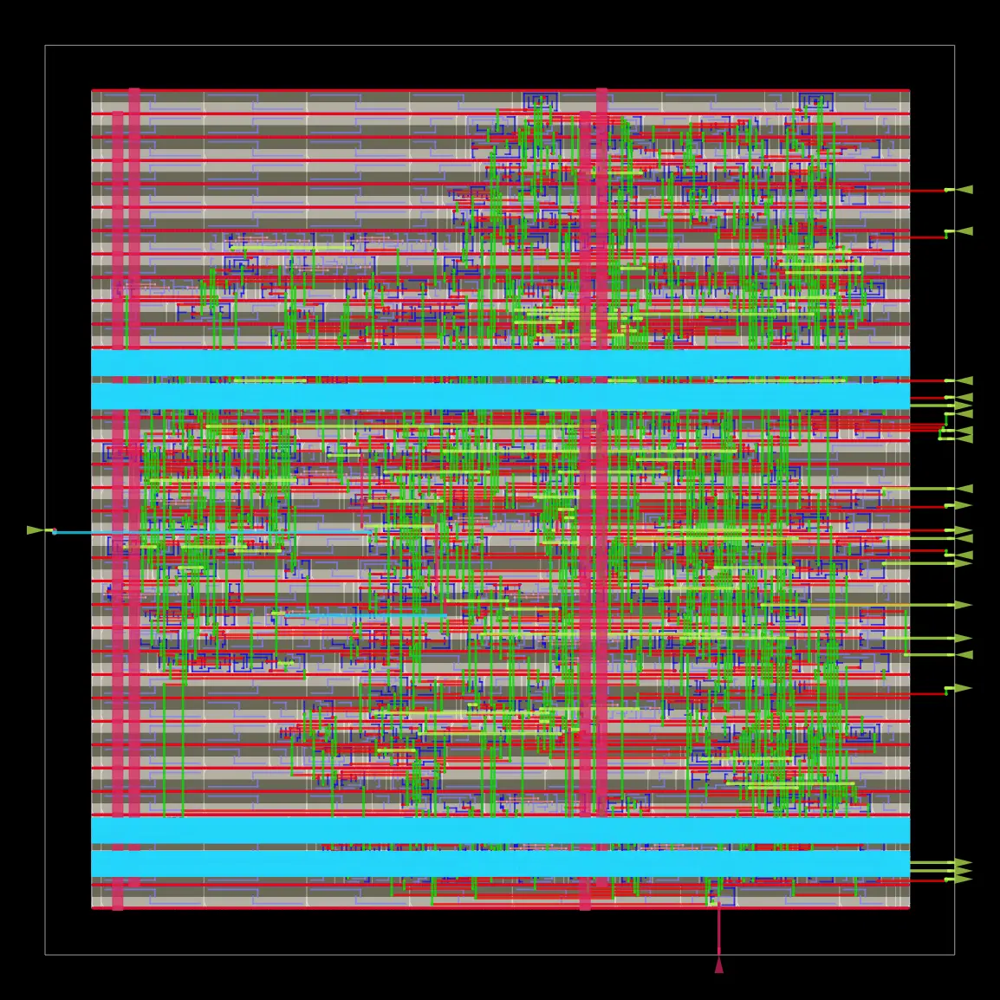

# Measuring distance one photon at a time

Can a computer design a circuit that measures distance from single photons
without storing a histogram? This project searches for that circuit using real
single-photon sensor data, then takes the best design all the way to a chip
layout.

The chosen circuit keeps **18 bits of memory per pixel** instead of a histogram
of about **8,000 bits**. It measures distance to within **34 cm on 76% of
pixels**, and its layout fits in a **10.5 µm square** in a predictive 7 nm
process.

## Motivation

A lidar camera measures distance by sending out a short flash of laser light
and timing how long the light takes to bounce back. Many lidar sensors use
**single-photon avalanche diodes (SPADs)**, detectors sensitive enough to record
when each individual photon arrives.

One photon on its own is not enough. Some photons are the laser reflecting off
the target, but many come from sunlight or room light and arrive at random
times. The usual approach is to collect many photons into a **histogram** (a
tally of how many photons arrived in each time slot) and pick the tallest bar.
That works well, but every pixel needs a counter for each of 672 time slots,
about 8,064 bits of memory. Across a sensor with thousands of pixels, that
memory takes up much of the chip.

This project asks a different question: can a small circuit watch the photons
go by, one at a time, and keep only a running guess? And can a computer find
that circuit from examples instead of an engineer designing it by hand?

## How the circuit works



Each pixel has its own copy of the circuit. Every time a photon arrives, the
circuit receives its arrival time as a number from 0 to 671. Each step is 750
picoseconds, which equals 11.2 cm of distance, so the circuit covers about 75 m.

The circuit has three parts:

1. **Memory.** A 10-bit register holds the current distance guess, and a 4-bit
   counter holds how confident the circuit is in that guess (0 to 15). Up to 4
   extra memory bits are free for the search to use however it likes.
2. **A fixed comparator.** It compares each photon with the current guess and
   answers simple yes/no questions. Is the photon within 1, 2, 4, 8 or 16 steps
   of the guess? Is it earlier or later? Is the confidence zero, at least 2, at
   least 4, at least 8, or full?
3. **A learned controller.** Up to 48 logic gates, in 3 layers of 16, read
   those answers and the extra memory bits. They decide what each photon does:
   replace the guess, move it one step later or earlier, raise or lower the
   confidence, and update the extra memory.

The memory and comparator are designed by hand. The controller, the part that
decides how the circuit actually behaves, is found by the search.

## How the search learns

The data comes from **[SP-TransientBench](https://huggingface.co/datasets/shuinb/SP-TransientBench)**,
a public set of real SPAD recordings of indoor and outdoor scenes. Each pixel
has its recorded photon histogram and a reference distance. Training replays
real photon streams drawn from those histograms.

- Whole recordings are split into training, design, validation and held-out
  test sets, so the circuit is never scored on a scene it learned from.
- Each training example uses a random number of photons (16 to 256) and a
  random amount of extra background light, so the circuit has to work in both
  easy and hard conditions.
- The held-out test recordings, including a whole outdoor parking-lot scene,
  have not been used yet. They are saved for one final check after the design
  is frozen.

The search runs in stages:

1. **Undecided gates (DARTS).** Each gate starts as partly every logic function
   and partly connected to every input it could read, as in the
   [full adder](../basics/full-adder-discovery/README.md) experiment. Training
   nudges these choices toward fewer mistakes. Gate functions learn on the
   training recordings; the wiring learns on a separate design recording.
2. **Snapping to a real circuit.** Each gate takes its most likely choice.
3. **Trial and error.** The program makes hundreds of small random changes at a
   time (one gate's function, one wire), simulates every changed circuit exactly
   on thousands of photon streams, and keeps the best. This stage did most of
   the work.
4. **Picking the winner.** The final choice is made on validation recordings
   that the search never trained on.

During training only, a "physics check" penalizes distances that the photons do
not support, without looking at the correct answers. It is not part of the chip.

Two simple tests catch circuits that only look good:

- A circuit that ignores the photons and always answers the most typical
  distance has an average error of **1.97 m**. A useful circuit must beat that.
- If every photon is delayed by 24 steps, the answer must move by exactly 24
  steps. The chosen circuit passes on 100% of pixels.

## What it found

Measured on the validation recordings, with random photon counts and background
light, all methods on the same photons:

| | Learned circuit | Hand-written rule (same hardware) | Histogram, tallest bar |
|---|---|---|---|
| Average error | **0.363 m** | 2.25 m | 0.354 m |
| Median error | **0.151 m** | 0.189 m | 0.184 m |
| Within 34 cm (3 steps) | **76.2%** | 70.0% | 71.6% |
| Memory per pixel | 18 bits | 14 bits | about 8,064 bits |

The learned circuit matches the histogram method on average error and beats it
on median error, while storing about 450 times less. A smoother histogram
method (an 8-step box filter) does better still, with 79.7% of pixels within
34 cm, but it also needs the full histogram.



Only 26 of the 48 gates do real work. Once it has locked on, the circuit
behaves like this:

- A photon 5 to 16 steps after the guess always moves the guess one step later.
- Photons near the guess, or earlier, usually leave it alone. Depending on the
  extra memory bits, they occasionally move it one step earlier.
- Photons more than 16 steps away are ignored as background light.

The controller's logic written as equations is in
[`circuits/final/equations.txt`](circuits/final/equations.txt).

Some other things the results show:

- **About 64 photons are enough.** Accuracy at 64 photons (0.286 m average
  error) is nearly the same as at 256 (0.280 m). Twenty-four photons already
  put 70% of pixels within 34 cm.
- **The answer stays steady.** The average offset changes by less than 1 step
  (11 cm) between 16 and 256 photons.
- **It can be made smaller.** Rerunning the search with chip area as the goal
  found a version 8% smaller (24.68 µm², 253 cells, 17 memory bits) with the
  same accuracy. It is in [`circuits/area-optimized/`](circuits/area-optimized/).

## From circuit to chip layout



The chosen circuit was turned into a real layout with
**[OpenROAD-flow-scripts](https://github.com/The-OpenROAD-Project/OpenROAD-flow-scripts)**,
an open-source tool chain that takes a circuit description through every step
of physical chip design: converting it into standard cells, placing those cells,
building the clock network, routing the wires and checking the result. The cells
come from **ASAP7**, a predictive 7 nm teaching library.

| Result | Chosen circuit |
|---|---|
| Timing | Met at a 1.5 ns clock, with 609 ps to spare |
| Fastest clock after routing | 682 ps, about 1.47 GHz |
| Die | 110 µm² (about 10.5 × 10.5 µm) |
| Cells | 451, using 44.1 µm² |
| Wire length | 916 µm |
| Design-rule errors after routing | 0 |
| Power | 71 µW, assuming the circuit switches on every clock |

The layout uses more cell area than the logic alone (26.8 µm²) because the flow
adds supporting cells for the clock, power connections and timing. The layout
files, timing reports and pictures are in
[`asic/results/`](asic/results/2026-11-10_final_batch3-random-s4-seed0_asap7_1500ps/README.md).

## Which extra goals are worth adding

The circuit runs far faster than photons arrive, so speed and power are not the
limits. Area is. After switching the search to area, six candidate extra goals
were tested side by side, each in its own folder under
[`constraints_lab/`](constraints_lab/README.md):

| Goal | Verdict | How |
|---|---|---|
| Steady answer across photon counts and background | Adopt | Final check: the offset may move at most 1 step |
| Fewer badly wrong pixels | Adopt | Final check: the share of pixels off by more than 1 m may rise by at most 0.2 percentage points |
| A "no target" output | Adopt | Report "valid" when the confidence counter is 8 or more: 97.6% of targets detected, 0.1% false alarms, almost no extra area |
| Tolerance to sensor effects (pile-up, timing jitter, bit errors) | Adopt as checks | Training on distorted photons made the circuit worse, so only check at the end |
| Settling quickly | Report only | Limiting it during the search cost area and bought nothing |
| Fewer memory bits | Do not adopt | Two of the extra memory bits are essential; removing either makes the error 25 times worse |

The biggest lesson was not about any one goal. The design recordings and the
validation recordings disagree more than expected. A change that improved error
on the design recordings sometimes made validation error 38% worse. Only the
final check on validation keeps the search honest.

## Starting without a fixed design

The [`freeform/`](freeform/README.md) folder asks whether the search can find a
working circuit with no hand-designed comparator or counter at all, given only
the raw photon times and a set of memory bits. So far it cannot do much: the
best attempt has an average error of 1.68 m, only a little better than ignoring
the photons (1.97 m). The hand-designed comparator gives the search a large head
start.

## Limitations

- **This is an exploration, not a chip ready to make.** ASAP7 is a predictive
  library that cannot be manufactured. The area and speed numbers are realistic
  estimates.
- **The final test has not been run.** All accuracy numbers come from
  validation recordings. The held-out recordings are saved for one final check.
- **Many results come from a single run.** Training includes randomness, and
  different random starts reach circuits between 22.8 and 26.8 µm² with the same
  settings.
- **Sensor effects are modelled, not measured.** In a pile-up model (several
  photons competing in one laser pulse), the chosen circuit's answer shifts by
  3.8 steps, just over the proposed limit of 3. The area-optimized version
  shifts by 2.8.
- **The power figure is pessimistic.** It assumes the circuit switches on every
  clock, while real photons arrive far less often.
- **The dataset is not included.** SP-TransientBench is licensed CC BY-NC-SA
  4.0. The download script fetches it (about 2.2 GB after preparation).

## What's in this folder

| Folder or file | Purpose |
|---|---|
| [`spad/`](spad/) | The code: data preparation, circuit model, training, hardware export and evaluation |
| [`circuits/`](circuits/README.md) | The chosen circuit and its area-optimized version, with logic diagrams, equations and Verilog |
| [`asic/`](asic/README.md) | OpenROAD flow inputs, scripts and the routed layout |
| [`constraints_lab/`](constraints_lab/README.md) | The six extra-goal experiments, each with its own report |
| [`freeform/`](freeform/README.md) | The search with no fixed design |
| [`kaggle/`](kaggle/README.md) | Notebook and launcher for training on Kaggle GPUs |
| [`tests/`](tests/) | Automated checks for the simulators, data handling and hardware export |
| [`RESULTS.md`](RESULTS.md) | Detailed results of every training batch |
| [`docs/technical-notes.md`](docs/technical-notes.md) | Detailed design notes |
| [`archive/`](archive/README.md) | Earlier designs and layouts |

## Running it

You need Python with the packages in [`requirements.txt`](requirements.txt).
Run everything from this `SPAD/` folder:

```bash
python -m spad.dataset.download      # fetch SP-TransientBench
python -m spad.dataset.prepare       # prepare the photon data
python -m spad.hardware.costs        # read ASAP7 cell sizes and delays
python -m spad.dataset.calibration   # refine the reference distances
python -m spad.dataset.scenes        # add the larger scenes
python -m unittest discover -s . -t .
```

To train and shrink a circuit, then check its real area:

```bash
python -m spad.training.train_stream --help
python -m spad.training.train_stream --objective area --init circuit \
  --init-circuit circuits/final/circuit.json --steps 0 --out runs/my-area-run
python -m spad.hardware.synth runs/my-area-run/circuit.json
```

To draw a circuit's controller, equations and Verilog:

```bash
python -m spad.hardware.diagram circuits/final/circuit.json --out my-diagrams --no-netlist
```

The chip layout needs Docker. [`asic/README.md`](asic/README.md) explains how to
lay out a circuit with `asic/run_flow.sh`.
