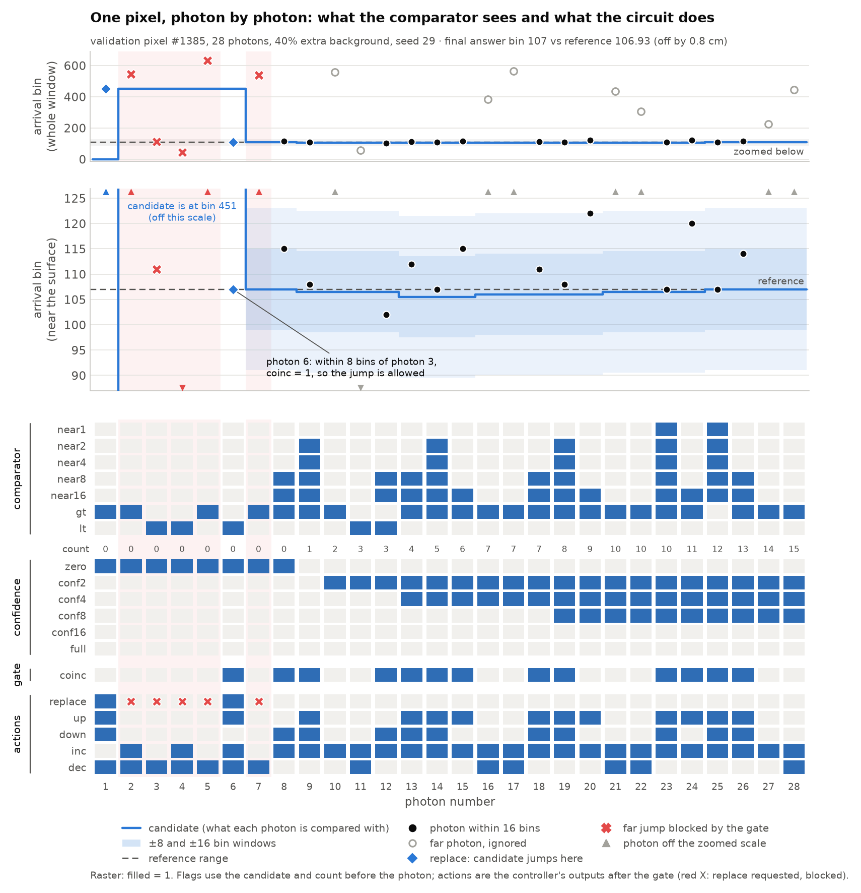
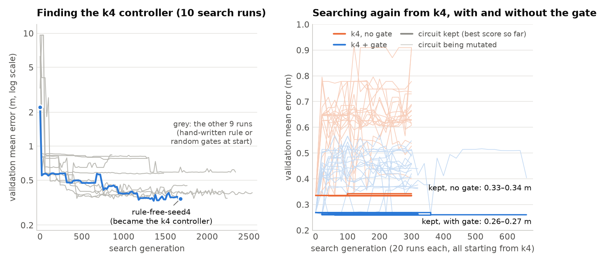
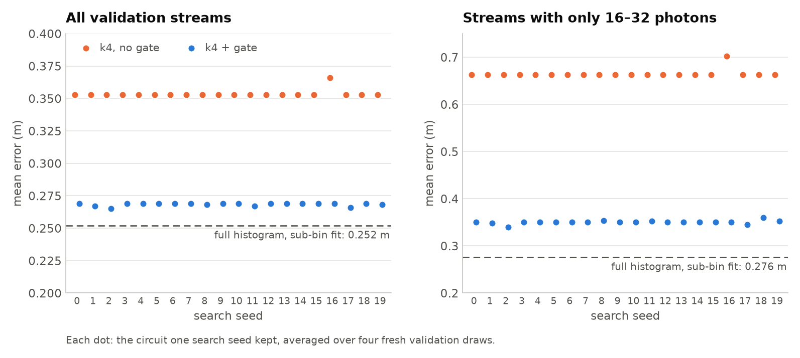
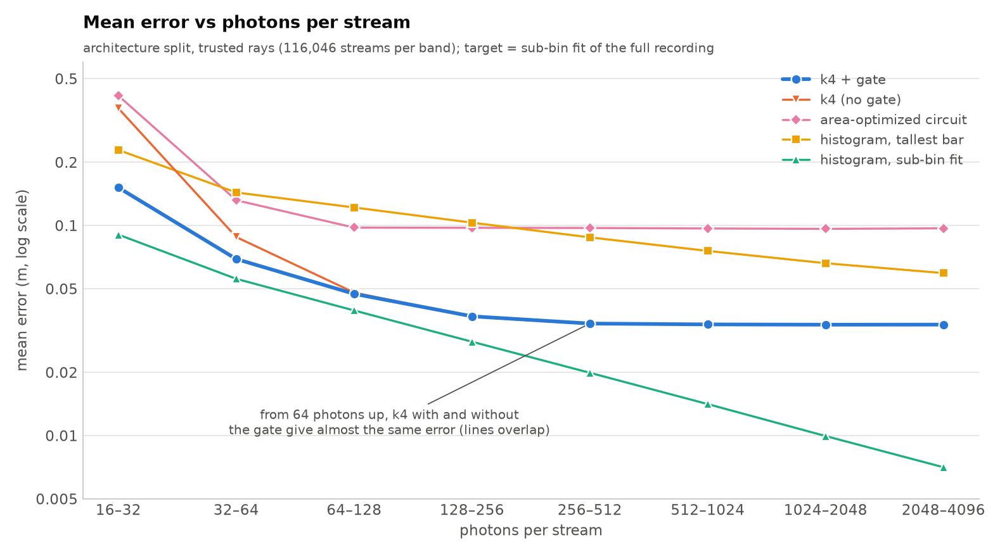
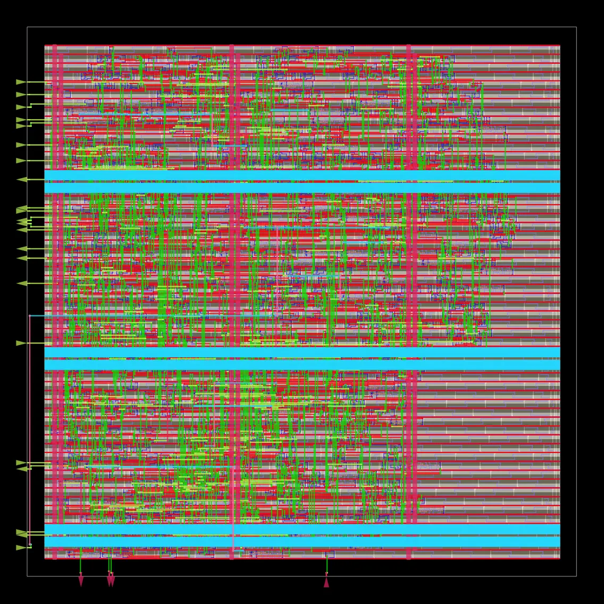

# Accuracy-focused circuit: k4 + coincidence gate

How close can a small circuit under each pixel get to a full photon histogram?
This circuit keeps one running distance guess in 1/8-bin steps (1.4 cm). Its
learned controller is called **k4**, and a **coincidence gate** stops a lone
background photon from pulling the guess away.

With only 16-32 photons per pixel its mean error is **0.173 m**. A full
histogram read with a sub-bin fit gets 0.104 m, and k4 without the gate
0.411 m. It uses **66 flip-flops** instead of a histogram's about 8,064 bits,
and its layout is **281 µm²** in a predictive 7 nm process.

## 1. The problem

A lidar pixel built from a **single-photon avalanche diode (SPAD)** times
individual laser photons coming back from a surface. Time is counted in bins of
750 ps, which is 11.24 cm of range, and there are 672 bins, about 75 m. Many
photons come from background light and arrive at random times. The usual method
counts photons into a **histogram**, 672 counters of 12 bits (about 8,064 bits
per pixel), and picks the peak.

This circuit keeps a single running guess instead, the **candidate**, and
updates it on every photon. The candidate starts at bin 0 with confidence 0.
The [area-optimized circuit](../area-optimized/README.md) asks how small such a
circuit can be. This one asks how accurate it can be, so its search scored
accuracy only, with no area term.

The data is **SP-TransientBench**, real SPAD recordings split into training,
architecture (design), validation and held-out test sets. The held-out test
recordings have never been loaded.

## 2. Fixed comparator, learned controller

Each pixel has its own copy of three parts:

- **A fixed comparator**, designed by hand. It compares each photon's arrival
  bin with the candidate and outputs yes/no flags: `near1` to `near16` (within
  1, 2, 4, 8 or 16 bins), `gt` / `lt` (later / earlier), and the confidence
  flags `zero`, `conf2` to `conf16` and `full`.
- **A learned controller (k4)**: 3 layers of 40 two-input gates and 8 memory
  bits, `state0` to `state7`. Training chose each gate's two inputs and truth
  table. It reads the flags and the memory and decides the actions: `replace`
  (the candidate jumps to this photon), `up` / `down` (move the candidate a step
  later / earlier), `inc` / `dec` (confidence +1 / -1) and the memory bits for
  the next photon.
- **A datapath**: the candidate with 3 fractional bits, a 2-bit step size
  (1, 1/2, 1/4 or 1/8 bin), a 5-bit confidence counter and the coincidence gate.

Only 17 of the 120 gates do real work. Five of the learned equations, from
[`circuit/equations.txt`](circuit/equations.txt):

```
do_replace  = (lt & zero) | (zero & ~near16)
do_inc      = near8 | state1
do_dec      = ~near8 & ~state3
next_state1 = full | near16 | ~state4
next_state3 = near8
```

The candidate only jumps when confidence is zero. The memory bits are written
on one photon and read on the next. `state3` is the previous photon's `near8`.
`state1` is set if the previous photon was within 16 bins, confidence was
full, or `state4` was 0 (`state4` is never set two photons in a row). So
confidence rises when this photon is within 8 bins or `state1` is set, and
falls when this photon and the one before both land more than 8 bins away. The
gates that do work are drawn in [`circuit/controller.svg`](circuit/controller.svg).

## 3. The coincidence gate



Without the gate, k4's mean error at 16-32 photons was dominated by rare large
misses. While confidence is zero, one background photon far from the surface
can make the candidate jump away.

The gate came out of a design study and lives in the fixed datapath:

- A 4-entry FIFO (first in, first out) holds the arrival bins of the last 4
  photons. `coinc` is 1 when this photon is within 8 bins of at least one of
  them.
- An `acquired` flip-flop is set by the first replace and stays set, so the
  very first jump is never blocked.
- After that, a replace to a far photon (more than 16 bins from the candidate)
  is blocked unless `coinc` is 1. A blocked replace also clears `up` and
  `down`, so the candidate holds.

Real surfaces return photons close together in time. Background photons are
spread over all 672 bins, so two of them rarely land within 8 bins of each
other. The controller was not retrained: k4's gates are unchanged.

The figure follows one real validation pixel with 28 photons and 40% extra
background. The top panels show each photon's arrival bin and the candidate
(blue line); the raster below shows every flag and action per photon (filled
= 1, red X = replace blocked by the gate). Flags use the candidate and
confidence before the photon; actions are after the gate.

- Photon 1 is background (bin 451). Confidence is zero and nothing is acquired
  yet, so the candidate jumps from bin 0 to 451.
- Photons 2, 4 and 5 are far background. The controller asks to replace and
  the gate blocks it.
- Photon 3 (bin 111) is a real surface photon, also blocked: nothing earlier
  confirms it.
- Photon 6 (bin 107) is within 8 bins of photon 3, so `coinc` = 1 and the jump
  to the surface goes through. Photon 7 (bin 539) is blocked.
- From there confidence climbs, the controller stops asking to replace, and
  `near`/`gt`/`lt` drive small up/down steps around the surface.

The final answer is bin 107.0 against a reference of 106.93: 0.8 cm off.

## 4. How it was found



**Finding k4 (left).** Ten search jobs ran together on Kaggle (2 Tesla T4
GPUs, about 100 minutes in all): 2 starting points × 5 seeds. One start was
random gates. The other was a **hand-written rule**: jump to a photon when
confidence is zero and the photon is more than 8 bins away; otherwise step
toward a photon within 8 bins; confidence +1 for a photon within 8 bins (or
when it is zero), -1 otherwise. Two of the seeds first ran 600 steps of
gradient training (DARTS, which turns each gate's choice of inputs and truth
table into a weighted blend that gradient descent can tune); the rest used the
search alone. Each generation copies the current best circuit 1,024 times,
changes each copy (flip one truth-table entry or rewire one gate input), scores
every copy exactly on 4,096 real photon streams, and keeps the best. A job
stops after 500 generations without improvement.

The winner (blue) started from the hand-written rule with no gradient steps.
Its validation error fell from 2.2 m at generation 0 to 0.342 m at generation
1,680. Random starts began at 3.3-9.6 m and ended higher.

**Searching again (right).** 40 more runs started from k4, 20 seeds without
the gate (orange) and 20 with it (blue). Thin lines are the copies being
changed; thick lines are the circuit kept. The kept circuit barely moves:
0.33-0.34 m without the gate, 0.26-0.27 m with it. 18 of 20 seeds without the
gate ended on k4 unchanged, and 13 of 20 with the gate ended on their start
circuit.



Each dot is the circuit one seed kept, averaged over four fresh validation
draws. On all streams the gate gives 0.265-0.269 m against 0.353 m without it
(one seed got worse, 0.366 m). With 16-32 photons the gap is wider: 0.340-0.360
m against 0.663 m. The dashed line is the full histogram with the sub-bin fit
(0.252 m and 0.276 m). The gain comes from the gate, not from searching again.

These numbers are scored against the reference labels on all validation rays,
including rays where the labels disagree with the SPAD data, so they are higher
than the numbers below.

## 5. How accurate it is

The reference labels come from a separate lidar and, on many rays, disagree
with the pixel's own data even when every recorded photon is used. So the final
scores use **trusted rays**: at least 1,024 recorded photons, with the sub-bin
fit of the full recording within 3 bins of the label. The target is that
full-recording fit. The **sub-bin fit** reads a 672-counter histogram by
matching it against the laser pulse's shape and then taking the weighted centre
of the best match, which lands between bins.

Benchmark on 15 architecture recordings, 16,029 trusted rays, 128,232 streams
per band, every method on the same photons
([`validation/benchmark_lowphoton-v1.txt`](validation/benchmark_lowphoton-v1.txt)),
mean error in metres:

| Photons | k4 + gate | k4 | Histogram, tallest bar | Histogram, sub-bin fit |
|---|---|---|---|---|
| 16-32 | **0.173** | 0.411 | 0.296 | 0.104 |
| 32-64 | **0.076** | 0.102 | 0.180 | 0.064 |
| 64-128 | **0.055** | 0.056 | 0.151 | 0.045 |
| 128-256 | **0.047** | 0.047 | 0.131 | 0.032 |

At 16-32 photons the gate cuts large misses (more than 9 bins off) from 1.06%
to 0.35% of streams. The median barely changes (0.078 m), so the gate fixes
big misses, not typical precision. k4 + gate stays 0.069 m behind the histogram
fit; the 95% confidence interval of that gap is 0.063-0.076 m.



A larger run extends this to 4,096 photons, on a log scale. It uses trusted
rays with at least 4,096 recorded photons and its own photon draws (116,046
streams per band), so its values differ a little from the table: 0.151 m for
k4 + gate at 16-32 photons, 0.090 m for the sub-bin fit. k4 + gate (thick blue)
beats the tallest bar and the area-optimized circuit in every band. From 64
photons up, k4 with and without the gate overlap: the gate matters only when
photons are few. From 256 photons on, k4 + gate levels off at about 0.034 m
while the sub-bin fit keeps improving to 0.007 m. That floor comes from the
circuit's step size and gain. The area-optimized circuit levels off at about
0.097 m.

**Delay test.** A circuit that memorised typical distances, instead of tracking
photons, would get worse if every stream were delayed by 300 bins. Only
surfaces that stay inside the 672 bins after the delay can be scored, which is
an easier subset: at 16-32 photons k4 + gate gets 0.148 m delayed (0.173 m on
all streams) and the histogram fit 0.099 m (0.104 m). The error does not grow.

## 6. Layout



The finished 281 µm² die, seen from above. The horizontal stripes are rows of
standard cells, the thin red, green and blue lines are routed wires on
different metal layers, the wide cyan and pink bars are the power grid, and the
arrows on the left and bottom edges are the input and output pins. The cells
fill about 47% of the core; most of the wiring sits on the left and in the
middle. The table below gives the numbers.

The circuit was laid out with OpenROAD-flow-scripts and **ASAP7**, a predictive
7 nm teaching library that no factory makes. The flow goes synthesis,
floorplan, placement, clock tree, routing, GDSII.

| Result | k4 + gate | Area-optimized |
|---|---|---|
| Die | 281.0 µm² | 110 µm² |
| Cells | 1,134 (116.5 µm²) | 451 |
| Memory | 66 flip-flops | 18 bits |
| Fastest clock | 743 ps (1.35 GHz) | 682 ps (1.47 GHz) |
| Setup slack at 1.5 ns | +566 ps | +609 ps |
| DRC errors | 0 | 0 |
| Power, switching every clock | 257 µW | 71 µW |

The fastest clock counts paths between the core's own flip-flops. The slack
also counts paths from the input pins, which the constraints give only 80% of
the 1.5 ns clock: 20% (300 ps) is reserved for logic outside the core.

## Limitations

- **Still behind the histogram with few photons**, and levels off at 0.034 m
  with many photons.
- **2.6 times the area** of the area-optimized circuit, still tiny next to a
  histogram.
- **ASAP7 cannot be manufactured.** Area and speed are estimates; no tapeout is
  planned.
- **The held-out test recordings have not been scored.**
- **The power figure is pessimistic.** Real photons arrive far less often than
  every clock.
- **The dataset is not included.** SP-TransientBench is licensed CC BY-NC-SA
  4.0; the download script fetches it into `../data/`.

## What's in this folder

| Folder | Purpose |
|---|---|
| [`asic/`](asic/README.md) | Verilog, synthesis, the OpenROAD flow and the routed layout |
| [`circuit/`](circuit/README.md) | The final circuit: `circuit.json`, equations, gate diagrams, the flags figure |
| [`validation/`](validation/README.md) | Benchmark, seed comparison and large-run scores behind the numbers above |
| [`training/`](training/README.md) | The circuit model, exact simulators, dataset code and the search |

## Running it

Run everything from `SPAD/accuracy-focused/` with the packages in
[`../requirements.txt`](../requirements.txt). Prepare the data once:

```bash
python -m training.dataset.download     # fetch SP-TransientBench into ../data/
python -m training.dataset.prepare      # prepare the photon data
python -m asic.synthesis.costs               # read ASAP7 cell sizes and delays
python -m training.dataset.calibration  # refine the reference distances
python -m training.dataset.scenes       # optional: add the larger scenes
```

Score the circuit, synthesize it, and lay it out:

```bash
python -m validation.benchmark k4gate=circuit/circuit.json --set decision --out bench.json
python -m asic.synthesis.synth circuit/circuit.json
asic/run_flow.sh
```

- The benchmark takes each design as `name=circuit.json`; the name labels its
  row. `--set decision` scores the 15 recordings behind the table in section 5
  (`--set dev` is a separate set for trying things out).
- `synth` checks the gate netlist against the simulator bit for bit, then maps
  it to ASAP7 cells and reports area.
- `run_flow.sh` needs Docker and runs the whole layout flow in a pinned
  OpenROAD-flow-scripts image; results land in `asic/flow/`. A step name such
  as `asic/run_flow.sh synth` runs only that step.

The exact search commands for k4 and the gate are in
[`training/README.md`](training/README.md).

For the smaller circuit, see [`../area-optimized/README.md`](../area-optimized/README.md).
