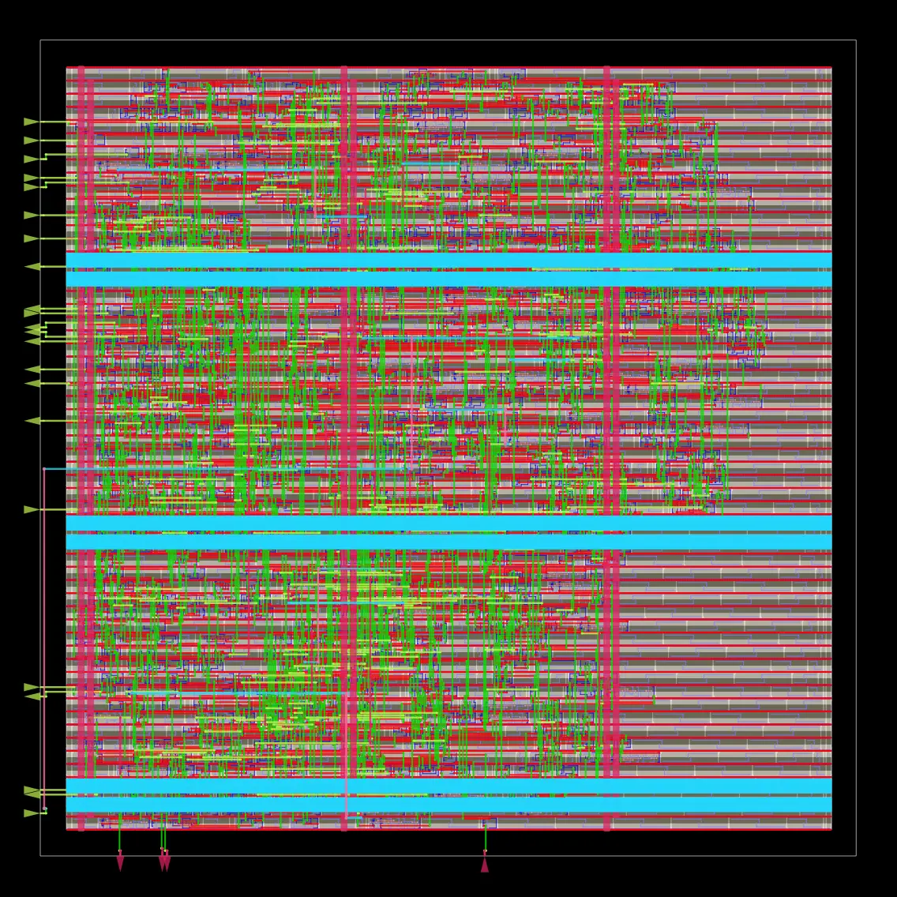
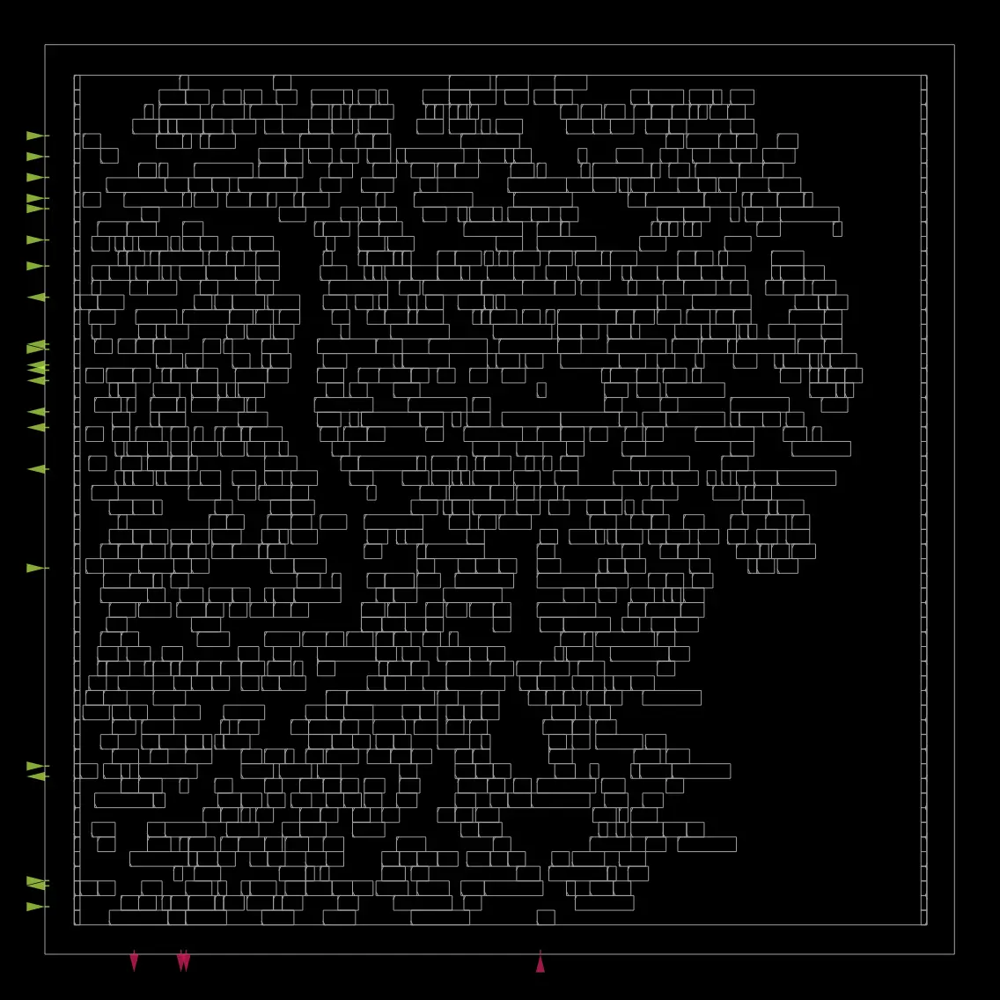

# ASIC: synthesis and layout (ASAP7)

Turns [`../circuit/circuit.json`](../circuit/circuit.json) into a routed chip
layout for one pixel's circuit. OpenROAD-flow-scripts (ORFS), run in Docker, does
six steps:

1. **Synthesis** (Yosys): Verilog to a netlist of ASAP7 standard cells.
2. **Floorplan**: die size and power grid.
3. **Placement**: cells into rows, pins onto the edge.
4. **Clock tree**: buffers that carry the clock to every flip-flop.
5. **Routing**: metal wires between the cells, checked against the
   design rules (DRC: spacing, width and similar).
6. **GDSII**: the final layout file.

ASAP7 is a predictive 7 nm teaching library: no factory makes it, so area and
speed are estimates.



The finished die. Pins are on the left and bottom edges. The wide horizontal and
vertical bands are the power grid. The thin green (vertical) and red (horizontal)
lines are mostly signal wires. Most of the wiring sits in the left three quarters;
the right edge and lower-right corner are nearly empty, since the cells take up
only 47% of the core.

## Files

| Path | What it is |
|---|---|
| [`designs/photon_core/photon_core.v`](designs/photon_core/photon_core.v) | The whole core in Verilog, generated from `circuit.json`: comparator, confidence counter, step-size logic, coincidence FIFO and gate, learned controller. Do not edit by hand |
| [`designs/photon_core/constraint.sdc`](designs/photon_core/constraint.sdc) | 1.5 ns clock; inputs and outputs get 20% of the period each |
| [`designs/photon_core/config.mk`](designs/photon_core/config.mk) | ORFS settings: ASAP7, square core, 45% utilization |
| [`run_flow.sh`](run_flow.sh) | Runs the flow in a pinned `openroad/orfs` Docker image. Output goes to `flow/` (scratch, not in git) |
| [`draw_gates.py`](draw_gates.py) | Draws `layout/6_final.v` with gate symbols as [`../circuit/gates.svg`](../circuit/gates.svg). Needs Yosys and Node.js |
| [`layout/6_final.gds`](layout/6_final.gds) | The final layout (GDSII) |
| [`layout/6_final.def`](layout/6_final.def) | The placed and routed design (DEF) |
| [`layout/6_final.v`](layout/6_final.v) | The routed netlist of ASAP7 cells |
| [`layout/6_finish.rpt`](layout/6_finish.rpt) | Final report: timing paths, slack, clock skew, slew and load checks, power |
| [`layout/synth_stat.txt`](layout/synth_stat.txt) | Yosys cell counts and area after synthesis |
| [`layout/summary.json`](layout/summary.json) | The key numbers below |
| `layout/final_*.webp` | Pictures from the flow: [all layers](layout/final_all.webp), [placement](layout/final_placement.webp), [routing](layout/final_routing.webp), [clock tree](layout/final_clocks.webp), [congestion](layout/final_congestion.webp), [worst timing path](layout/final_worst_path.webp) |
| [`__init__.py`](__init__.py) | Makes `asic` a package. `ROOT` points at `SPAD/`, where the shared `data/` and `runs/` live |
| [`synthesis/verilog.py`](synthesis/verilog.py) | `stream_verilog` exports a `circuit.json` to Verilog. `Netlist` simulates a Yosys netlist for checks |
| [`synthesis/synth.py`](synthesis/synth.py) | Yosys synthesis to ASAP7 cells. Checks the netlist bit for bit against the Python simulator and reports area |
| [`synthesis/timing.py`](synthesis/timing.py) | Pre-layout timing estimate from the ASAP7 Liberty tables (no wires) |
| [`synthesis/costs.py`](synthesis/costs.py) | Area and delay of each 2-input truth table in ASAP7 cells, used as the training area penalty |
| [`synthesis/area_model.py`](synthesis/area_model.py) | Whole-core area estimate, fitted to synthesized circuits. Its coefficients are in [`area_model.json`](synthesis/area_model.json) |
| [`synthesis/diagram.py`](synthesis/diagram.py) | Draws `controller.svg` and `equations.txt` in [`../circuit/`](../circuit/README.md) |

## Key numbers

From [`layout/summary.json`](layout/summary.json): ASAP7 (ORFS default, fast-fast
libraries), 1.5 ns clock.

| | |
|---|---|
| Die area | 281.0 µm² (core 246.1 µm²) |
| Standard cells | 1,134, with 116.5 µm² of cell area (47% of the core) |
| Flip-flops | 66 |
| Fastest clock | 743 ps (1.35 GHz) |
| Setup / hold slack at 1.5 ns | +566 ps / +44 ps |
| Clock skew | 3.0 ps |
| Wire length | 2,457 µm |
| DRC errors | 0 |
| Power | 257 µW (switching every clock, pessimistic) |

For scale: the [area-optimized circuit](../../area-optimized/README.md) is
110 µm², and a full photon histogram needs about 8,064 bits per pixel against
these 66 flip-flops ([the problem](../README.md#1-the-problem)).



Each outline is one standard cell. They pack the left and middle of the core and
thin out to the right, leaving the lower-right corner empty. The floorplan sizes
the core so the synthesized cells (1,019 cells, 111.8 µm²) fill 45% of it.
Buffers and the clock tree added later bring the cells to 1,134 and 116.5 µm²,
47% of the core, so about half the core is spare.

## Rerun the flow (from SPAD/accuracy-focused/)

You need Docker. The first run downloads the ORFS image (several GB).

```bash
asic/run_flow.sh            # whole flow
asic/run_flow.sh synth      # one make target only, e.g. synth, floorplan, clean_all
```

| Variable | Default | What it does |
|---|---|---|
| `ORFS_CPUS` | no cap | CPU cap for the container |
| `ORFS_IMAGE` | the pinned 2026-11-10 image the saved layout used | Docker image to run |
| `ORFS_PLATFORM` | `--platform linux/amd64` | Platform flag for `docker run`. amd64 is emulated and slow on Apple silicon |

If you changed `circuit.json`, regenerate `photon_core.v` first (command in
[`../circuit/README.md`](../circuit/README.md#regenerate-from-spadaccuracy-focused)).

Outputs land in `asic/flow/{results,reports,logs}/asap7/photon_core/base/`
(paths as given in `run_flow.sh`). Check that `6_final.gds` and `6_finish.rpt`
are there, then copy what you want to keep into `asic/layout/`:

```bash
cp asic/flow/results/asap7/photon_core/base/6_final.{gds,def,v} asic/layout/
cp asic/flow/reports/asap7/photon_core/base/{6_finish.rpt,synth_stat.txt,final_*.webp} asic/layout/
```

No script writes `summary.json`; edit it by hand. Slack, fastest clock, skew and
power are in `6_finish.rpt`, the die size is the `DIEAREA` line of `6_final.def`
(in nm), and the cell, area, wire-length and DRC counts are in the flow's other
reports and logs. Then redraw `gates.svg` with
`python asic/draw_gates.py asic/layout -o circuit/gates.svg`.
