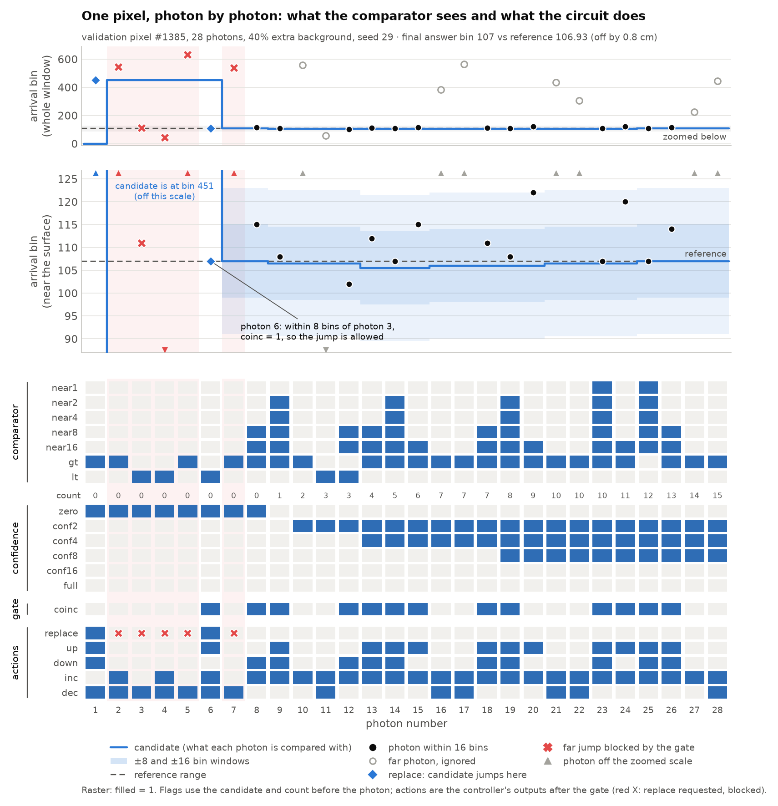

# The circuit: k4 + coincidence gate

The accuracy-focused circuit as data and diagrams. It sits under one SPAD
(single-photon) lidar pixel and keeps a running guess of the distance to the
surface, updated on every photon. Most photons are background light at random
times. Surface photons arrive close together, so the circuit has to follow them
and ignore the rest.

Time is counted in **bins** of 750 ps. Light goes out and back, so one bin is
11.242 cm of range (c × 750 ps / 2), and distance = bin × 11.242 cm. The window
is 672 bins (about 75 m). The circuit has two parts:

- **k4**, the learned controller: layers of 2-input gates whose wiring and truth
  tables were found by search. The name is the search batch that found it
  ([section 4 of the accuracy-focused README](../README.md#4-how-it-was-found)).
- **The coincidence gate**: fixed logic added afterwards that blocks lone far
  jumps (below).

`circuit.json` is the source. The Verilog is generated from it and lives only in
[`../asic/designs/photon_core/photon_core.v`](../asic/designs/photon_core/photon_core.v),
the input to the layout flow ([`../asic/README.md`](../asic/README.md)).

| File | What it is |
|---|---|
| `circuit.json` | The circuit: datapath sizes, and for each learned gate the two wires it reads and its truth table |
| `controller.svg` | Diagram of the 17 of 120 learned gates that do real work |
| `equations.txt` | The same logic as one Boolean equation per controller output |
| `gates.svg` | Every logic cell of the routed ASAP7 netlist ([`../asic/layout/6_final.v`](../asic/layout/6_final.v)) drawn with gate symbols |
| `flags_over_time.png` | One real pixel, photon by photon: flags, coincidence and actions |

## circuit.json

| Field | Meaning |
|---|---|
| `format` | `photon-stream-core-v1`, the file format name |
| `config` | The circuit's shape (next table) |
| `inputs` | The 24 named wires the first layer can read (next list) |
| `actions` | The 5 things a photon can do: `replace` (the candidate jumps to this photon), `up` / `down` (move it one step later / earlier), `inc` / `dec` (confidence +1 / -1) |
| `layers` | Three layers of 40 gates. `inputs`: for each gate, the two wire numbers it reads. `truth_tables`: for each gate, its 4 output bits for input pairs 00, 01, 10, 11 |

The 24 `inputs`, in order (wire numbers 0 to 23). The comparator works them out
from the photon's arrival bin, the **candidate** (the current distance guess) and
the **confidence** counter (raised by photons near the candidate, lowered by far
ones), all as they were before the photon:

| Wires | Names | 1 when |
|---|---|---|
| 0-4 | `near1`, `near2`, `near4`, `near8`, `near16` | the photon is at most 1, 2, 4, 8 or 16 bins from the candidate |
| 5-6 | `gt`, `lt` | the photon is later / earlier than the candidate |
| 7 | `zero` | confidence is 0 |
| 8-11 | `conf2`, `conf4`, `conf8`, `conf16` | confidence is at least 2, 4, 8 or 16 |
| 12 | `full` | confidence is 31, the top of the 5-bit counter |
| 13-14 | `const0`, `const1` | never / always |
| 15 | `coinc` | the coincidence test passed (below) |
| 16-23 | `state0` to `state7` | the 8 memory bits |

| `config` field | Value |
|---|---|
| `cand_bits`, `frac_bits` | The candidate: 10 whole-bin bits plus 3 fractional bits, so 1/8 bin (1.4 cm) steps |
| `step_bits` | 2: the controller picks the up/down step, 1, 1/2, 1/4 or 1/8 bin |
| `conf_bits`, `conf_levels` | A 5-bit confidence counter (0 to 31) with flags at 2, 4, 8 and 16 |
| `state_bits` | 8 memory bits |
| `width`, `layers` | 40 gates per layer, 3 layers |
| `windows` | Sizes of the `near` flags in bins: 1, 2, 4, 8, 16 |
| `coincidence_depth` | 4: a FIFO keeps the arrival bins of the last 4 photons |
| `coincidence_window` | 8: `coinc` is 1 when this photon is at most 8 bins from at least one FIFO entry |
| `rivals`, `rival_*` | An option this circuit does not use (`rivals` = 0 turns it off) |

Wire numbers in `layers[*].inputs` are positions in a list. For layer 1, 0 to 23
are the `inputs` above. For layers 2 and 3, 0 to 23 are still the `inputs` and 24
to 63 are the 40 gates of the layer before. In the last layer, gates 0 to 7 give
the next memory bits, 8 to 12 the 5 actions and 13 to 14 `step_select0` and
`step_select1`. The other gates are not used.

### The coincidence gate

The gate is fixed logic in the datapath, not a learned gate, so it is not in
`layers`. It only uses the two `coincidence_*` fields:

- An `acquired` flip-flop is set by the first replace.
- After that, a replace to a photon more than 16 bins from the candidate
  (`near16` = 0) is blocked unless `coinc` = 1.
- A blocked replace also clears up and down, so the candidate holds. inc, dec,
  step select and memory bits pass through.
- Every photon enters the FIFO, blocked or not.

Surface photons arrive close together in time. Background photons are spread over
all 672 bins, so two of them rarely land within 8 bins of each other.
k4's gates are unchanged from before the gate was added. `coinc` is wired to them
as an input, but none of them reads it.

## controller.svg

The learned gates that do work, read left to right: the input flags they use
(blue), the gates in layer order (yellow, labelled with their function such as
`NOT a AND b` or `XNOR`), and the 15 controller outputs (green). Look for what is
missing on the left: `coinc`, `gt`, `near2`, `near4` and `conf2` to `conf16` are
not read at all. `next_state2 = 0` and `next_state7 = 1` are constants (grey).
`near8` runs straight to `next_state3`, so memory bit 3 holds the last photon's
`near8`.

## equations.txt

The whole file:

```
# k4 + coincidence gate: learned controller
# 17 gates do real work out of 120
# impossible flag combinations are treated as don't-cares

next_state0 = ~state0
next_state1 = full | near16 | ~state4
next_state2 = 0
next_state3 = near8
next_state4 = ~state3 & ~state4
next_state5 = state5
next_state6 = ~zero
next_state7 = 1
do_replace = (lt & zero) | (zero & ~near16)
do_up = (lt & zero) | (zero & ~near16) | (near16 & ~lt & ~zero)
do_down = (near8 & state7) | (~near8 & ~state7)
do_inc = near8 | state1
do_dec = ~near8 & ~state3
step_select0 = (lt & near1) | (near16 & ~lt & ~near1)
step_select1 = full
```

How to read it:

- One line per controller output. The right side uses the flags and memory bits
  as they were before the photon: `~` is NOT, `&` AND, `|` OR, `0` and `1`
  constants. AND groups are in brackets wherever they meet an OR.
- `next_stateN` is memory bit N for the next photon. Memory bits start at 0.
- `do_replace` to `do_dec` are the controller's requests, before the coincidence
  gate. Replace wins over up and down. up and down together cancel, and so do inc
  and dec.
- `step_select1 step_select0`, read as a 2-bit number, sets the up/down step:
  00 = 1 bin, 01 = 1/2, 10 = 1/4, 11 = 1/8 bin.
- Flag combinations the comparator can never produce (for example `near1` without
  `near2`) are don't-cares: either output value is fine for them, so the
  equations are shorter than the gates.

What it says: the candidate only jumps when confidence is zero, and then only to
an earlier photon or to a photon more than 16 bins away (`near16` = 0).
Confidence goes up on a photon within 8 bins (or when memory bit 1 is set). It
goes down when this photon and the one before are both further than 8 bins
(`state3` is the last photon's `near8`). Once the counter is full, steps are 1/4
or 1/8 bin. `next_state7 = 1`, so from the second photon on `do_down` is just
`near8`.

## gates.svg

The routed netlist after layout, one symbol per ASAP7 standard cell, with the
cell name above it (`INVx1`, `NAND2x1`, `DFFHQNx1` and so on). Compound cells
(AND-OR, OR-AND, half and full adders) are drawn as their internal gates inside a
dashed outline. The drawing is unlabelled by block and large (about 9,500 by
30,000 px), so open it and zoom in. Look for the 66 `DFFHQNx1` flip-flops (the
registers: candidate, confidence, memory bits, FIFO) and the 122 `HAxp5` half
adders, the building block of the subtractors and counters.

## flags_over_time.png



Pixel #1385 from the validation recordings (kept apart from the training ones),
28 photons, with 40% extra background added. Top: every photon's arrival bin and
the candidate. Middle: zoom near the surface with the ±8 and ±16 bin windows.
Bottom: one row per flag and action (filled = 1). Flags use the candidate and
count before the photon. Actions are after the gate; a red X is a blocked replace.

Photon 1 is background, and with confidence at zero the candidate jumps to it.
Photons 2, 4, 5 and 7 are far background: replace is requested and blocked.
Photon 3 (bin 111) is a real surface photon, also blocked, because nothing before
it confirms it. Photon 6 (bin 107) is 4 bins from photon 3, so `coinc` = 1
and the jump is allowed. After that confidence climbs, the controller stops asking
to replace, and small up/down steps hold the candidate on the surface.

Final answer: bin 107.0 (12.029 m). The reference, the range a separate lidar
recorded for this pixel, is 106.93 bins (12.021 m): 0.8 cm off.

## Regenerate (from SPAD/accuracy-focused/)

`controller.svg` and `equations.txt` (needs `sympy`):

```bash
python -m asic.synthesis.diagram circuit/circuit.json --out circuit --no-netlist --title "k4 + coincidence gate"
rm circuit/core.v
```

The script also writes `core.v` into `--out`. The repo keeps the Verilog only in
`asic/`, so delete it, or pass another folder to `--out`.

The Verilog, after changing `circuit.json`:

```bash
python -c "import json; from asic.synthesis.verilog import stream_verilog; \
  print(stream_verilog(json.load(open('circuit/circuit.json'))), end='')" > asic/designs/photon_core/photon_core.v
```

`gates.svg`, from the routed netlist in `asic/layout/` (needs Yosys and Node.js):

```bash
python asic/draw_gates.py asic/layout -o circuit/gates.svg
```
