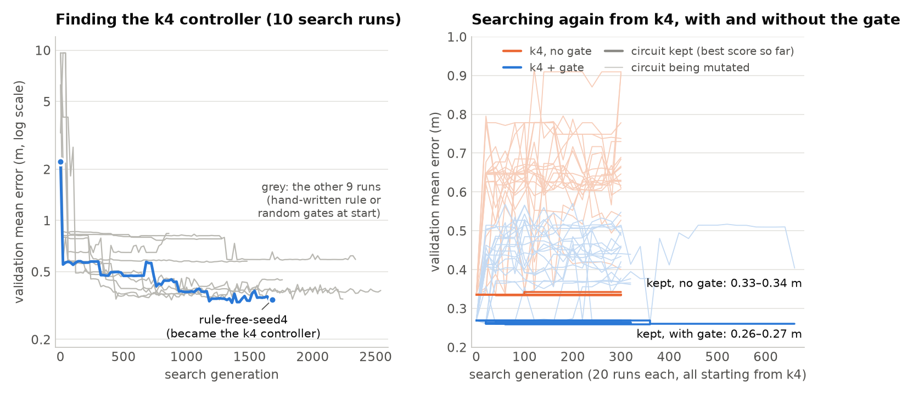

# neuralnetwork

The Python package that designed this folder's circuit. It turns real SPAD
recordings into photon streams, simulates the circuit on them exactly, and
searches for the circuit's gates: a gradient phase (DARTS, differentiable
architecture search), then an exact evolutionary search.

Run every command from `SPAD/accuracy-focused/`. Data goes to `SPAD/data/`,
shared by both circuits and not in git.

```
dataset: download -> prepare -> calibration -> scenes     (SPAD/data/)
photons: photon streams drawn from each ray's recorded histogram
core:    circuit model + exact integer simulators
train_stream: gradient phase -> exact search -> circuit.json -> ../asic/
```

## What is searched

A SPAD (single-photon avalanche diode) pixel times each returning laser photon.
Time is counted in **bins** of 750 ps, 0.1124 m of range; the time window is
672 bins (about 75 m).

- **Ray**: one pixel of one recording: its recorded histogram (photons per bin
  over the whole capture) and a reference distance from a separate lidar.
- **Photon stream**: a list of arrival bins, 16-256 of them in training, drawn
  at random from one ray's histogram. Each photon is swapped, with a random
  probability of up to 60%, for an arrival uniform over the 672 bins (extra
  background). See `sample_conditions`.

The circuit reads a stream one photon per clock. It holds a **candidate** (the
range guess, in bins with 3 fractional bits), a 5-bit **confidence** counter
and 8 memory bits. After the last photon, the candidate is the range.

For each photon:

1. A fixed **comparator** (designed by hand) compares the photon's bin with the
   candidate and outputs flags: `near1` ... `near16` (within 1/2/4/8/16 bins),
   `gt` / `lt` (later / earlier), and the confidence level `zero`, `conf2` ...
   `conf16`, `full`.
2. A learned **controller** maps the flags and memory bits to actions:
   `replace` (the candidate jumps to this photon), `up` / `down` (step the
   candidate later / earlier), a step size of 1, 1/2, 1/4 or 1/8 bin, `inc` /
   `dec` (confidence +1 / -1), and the next memory bits. It is 3 layers of
   two-input gates; the search chooses each gate's two inputs and truth table.
   **Width** is the number of gates per layer.

**k4** is the controller this search found (width 32, named after the search
batch that found it). **k4 + gate** is k4 placed unchanged in a width-40 core
with the coincidence gate added. That is the circuit in
[`../circuit/circuit.json`](../circuit/circuit.json); 17 of its 120 gates do
real work.

### The coincidence gate

A real surface returns photons close together in time; background photons are
spread over all 672 bins. The gate ignores a jump to a far photon unless a
recent photon landed near it.

A FIFO keeps the arrival bins of the last 4 photons. `coinc` = 1 when this
photon is within 8 bins of one of them. After the first `replace`, a `replace`
to a photon more than 16 bins from the candidate (`near16` = 0) goes through
only if `coinc` = 1. Otherwise it is blocked and `up` / `down` are cleared, so
the candidate holds. Confidence, step size and memory pass through unchanged.

One validation ray, 28 photons (drawn in
[`../circuit/flags_over_time.png`](../circuit/flags_over_time.png)):

| Photon | Bin | What happens |
|---|---|---|
| 1 | 451, background | Confidence is zero, so the candidate jumps to 451 (first `replace`). |
| 2, 4, 5 | far background | The controller asks to replace; no `coinc`; blocked. |
| 3 | 111, surface | Also blocked: no earlier photon within 8 bins confirms it. |
| 6 | 107, surface | Within 8 bins of photon 3 in the FIFO, so `coinc` = 1: the candidate jumps to 107. |
| 7 | 539, background | Far from 107, no `coinc`: blocked. |
| 8-28 | | Confidence climbs and the controller stops asking to replace; small up/down steps around the surface. |

Final answer 107.0 bins (12.029 m); reference 106.93 bins (12.021 m).

## Package map

| Module | What it does |
|---|---|
| `core/stream_model.py` | The circuit. `StreamCore` (differentiable, for the gradient phase); three integer simulators that must agree exactly (`simulate_stream`, `simulate_population`, bit-packed `simulate_population_packed`); `coincidence_trace` (the `coinc` signal); `rule_circuit` (a hand-written starting rule). |
| `core/model.py` | `GateLayer`: a layer of two-input gates with learnable wiring and truth tables. |
| `dataset/download.py` | Download a pinned, size-capped subset of SP-TransientBench and the ASAP7 cell libraries. |
| `dataset/prepare.py` | Project the lidar points into the SPAD image, turn distances into target bins, sample rays. |
| `dataset/calibration.py` | Refit the lens on training recordings; write the final labels and the clean mask (rays not on a depth edge). |
| `dataset/scenes.py` | Add multi-view Reconstruction scenes as extra recordings. |
| `dataset/photons.py` | Draw photon streams (`sample_conditions`); load a split (`load_rays`). |
| `training/train_stream.py` | The search: gradient phase, exact search, `embed_circuit`. |
| `training/police.py` | Label-free physics check: penalizes ranges the photons do not support. |
| `training/baselines.py` | Histogram methods, including the tallest bar and the sub-bin fit. |

Verilog export and synthesis are in [`../asic/synthesis/`](../asic/synthesis/).

## What is new for this circuit

| Feature | Flags |
|---|---|
| Sub-bin candidate: 1/8 bin, 1.4 cm | `--frac-bits 3` |
| Step select: two learned outputs pick a step of 1, 1/2, 1/4 or 1/8 bin | `--step-bits 2` |
| 5-bit confidence with a `conf16` flag | `--conf-bits 5 --conf-levels 2 4 8 16` |
| Coincidence gate. Fixed logic with no gradient model, so it needs `--steps 0`. `coinc` is also a controller input; k4 does not use it. | `--coincidence-depth 4 --coincidence-window 8` |
| `embed_circuit`: place a trained circuit in a larger core without changing what it computes; extra gates, memory bits and step select start as constant 0 | `--init circuit --init-circuit PATH --embed` |
| Accuracy only: no area penalty; Huber loss with delta 1 bin, each ray's loss capped at 8 bins; the circuit is picked by validation mean error with each ray capped at 9 bins (about 1 m); a winning mutant must also win on fresh rays from the other design split | `--area-weight 0 --loss-delta 1 --loss-cap 8 --select capped --confirm-accept` |

## How k4 + gate was found



Both panels: search generation across, validation mean error in metres up.

**Left: finding k4** (log scale). Ten jobs: two starts (the hand-written rule,
random gates) times five seeds. Seeds 0, 2 and 4 used no gradient steps; seeds
1 and 3 ran 600 gradient steps first. Each generation copies the current
circuit 1,024 times, mutates each copy (flips a truth-table entry or rewires a
gate input), scores every copy exactly on 4,096 rays, and keeps the best. Blue
is the winner, `rule-free-seed4`: from 2.216 m (the hand rule) to 0.342 m when
it stopped at generation 1680. Grey are the other nine; random starts began at
3.3-9.6 m, and runs ended between 0.342 and 0.839 m. The winner used no
gradient steps.

**Right: searching again from k4**, 20 seeds without the gate (orange) and 20
with it (blue). Thin lines are the circuit being mutated (0.35-0.9 m); thick
lines are the kept circuit: 0.33-0.34 m without the gate, 0.26-0.27 m with it.
The search barely moves the kept circuit. Scores on fresh photons are in
[`../validation/`](../validation/README.md).

`search_history.csv` holds the data behind the figure: one row per logged score
(every 20 generations, every 100 gradient steps).

| Column | Meaning |
|---|---|
| `batch` | `k4 search (no gate)` (10 jobs), `k4 re-search (no gate)` or `k4 + gate search` (20 jobs each) |
| `job` | e.g. `rule-free-seed4`, `plain-seed07` (no gate), `gate-seed02` |
| `phase` | `start`, `gradient step` or `generation` |
| `step_or_generation` | gradient step or search generation |
| `validation_mean_error_m` | mean error of the circuit being mutated (m) |
| `validation_capped_error_m` | the same with each ray capped at the selection cap: the selection score (m) |
| `best_capped_error_m` | best selection score so far, i.e. the kept circuit (m) |

## Commands

Data (once, shared with `area-optimized/`):

```
python -m neuralnetwork.dataset.download          # raw recordings + ASAP7 libraries
python -m neuralnetwork.dataset.prepare           # labelled rays per recording
python -m asic.synthesis.costs                    # data/asap7/costs.json
python -m neuralnetwork.dataset.calibration       # refit the lens, final labels
python -m neuralnetwork.dataset.scenes            # optional: extra Reconstruction scenes
```

k4 (the winning job; GPU). It stops after 500 generations without improvement:

```
python -m neuralnetwork.training.train_stream --out ../runs/k4 --device cuda \
    --init rule --steps 0 --seed 4 \
    --frac-bits 3 --step-bits 2 --width 32 --state-bits 8 --conf-bits 5 --conf-levels 2 4 8 16 \
    --area-weight 0 --loss-delta 1 --loss-cap 8 --select capped --confirm-accept \
    --population 1024 --search-rays 4096 --generations 3000 --patience 500 --min-generations 600 \
    --give-up-after 600 --give-up-score 0.6
```

The other nine jobs change `--seed`, use `--init random` for the random starts,
and add `--steps 600 --eval-every 100` for seeds 1 and 3.

k4 + gate: embed k4 in a width-40 core with the gate. `--generations 0` skips
the search, which gives the gates in `../circuit/circuit.json`.

```
python -m neuralnetwork.training.train_stream --out ../runs/k4-gate --device cuda \
    --init circuit --init-circuit ../runs/k4/circuit.json --embed --steps 0 --generations 0 \
    --frac-bits 3 --step-bits 2 --width 40 --state-bits 8 --conf-bits 5 --conf-levels 2 4 8 16 \
    --coincidence-depth 4 --coincidence-window 8
```

The 20-seed re-search with the gate is the same command with a search. It stops
after 300 generations without improvement. `--select-cap-bins 45` caps each ray
at 45 bins (about 5 m) instead of 9 when picking the circuit; `--random-delay`
shifts each ray's photons and target by a random number of bins, so a circuit
cannot learn where targets usually sit.

```
python -m neuralnetwork.training.train_stream --out ../runs/gate-seed0 --device cuda \
    --init circuit --init-circuit ../runs/k4/circuit.json --embed --steps 0 \
    --frac-bits 3 --step-bits 2 --width 40 --state-bits 8 --conf-bits 5 --conf-levels 2 4 8 16 \
    --coincidence-depth 4 --coincidence-window 8 \
    --area-weight 0 --loss-delta 1 --loss-cap 8 --select capped --select-cap-bins 45 \
    --confirm-accept --random-delay --generations 1500 --patience 300 --min-generations 300 --seed 0
```

The runs without the gate are the same, also embedded at width 40, without the
two `--coincidence` flags.

Each run writes `circuit.json`, `summary.json`, `history.jsonl` and `state.pt`
under `--out`; `--max-seconds` and `--resume` stop and continue a run. Run
`python -m neuralnetwork.training.train_stream --help` for every option.
