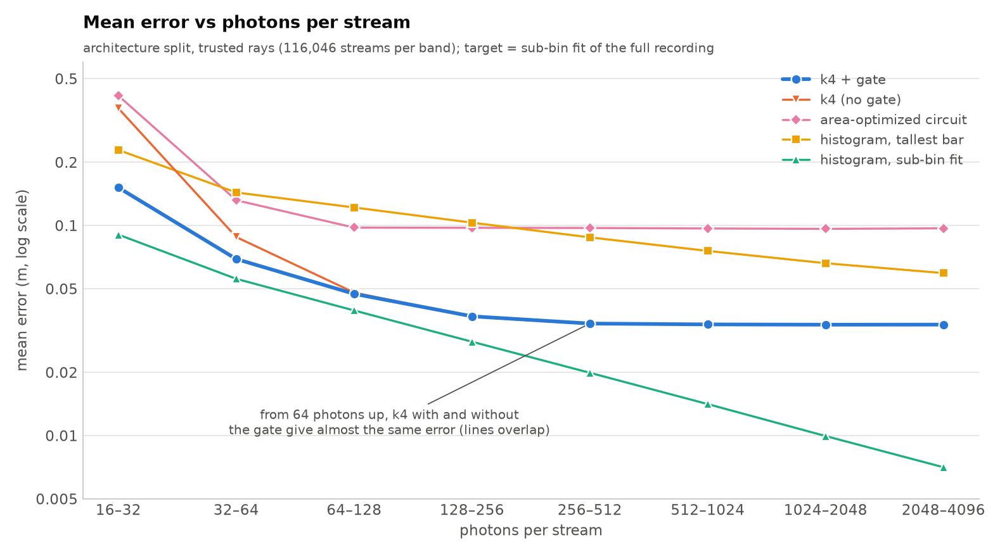
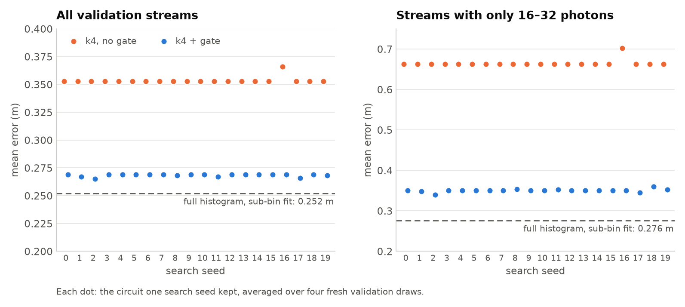

# validation

How accurately k4 + gate measures range, scored on photons drawn from real
recordings and compared with a full histogram given the same photons.

**k4 + gate** is this folder's circuit, [`../circuit/circuit.json`](../circuit/circuit.json).
k4 is its learned controller, found by the search in
[`../neuralnetwork/`](../neuralnetwork/README.md) and named after the search
batch that found it. The gate is fixed logic that stops the range guess from
jumping to a lone far photon. **k4** on its own means the same controller
without the gate.

Terms:

- **SPAD pixel** (single-photon avalanche diode): times each returning laser
  photon. Time is counted in **bins** of 750 ps, 0.1124 m of range.
- **Ray**: one pixel of one recording, with its recorded histogram (photons per
  bin over the whole capture).
- **Stream**: 16 to 4,096 arrival bins drawn at random from one ray's recorded
  histogram, some swapped for uniform background. A circuit reads them one at a
  time; a histogram method counts them into 672 bins.
- **Splits**: recordings are divided into train, architecture (used to choose
  designs), validation and held-out test. Test recordings are never loaded.
- **Area-optimized circuit**: the project's other circuit, searched for small
  area ([`../../area-optimized/`](../../area-optimized/README.md)).
- **Design study**: other circuits tried while designing the gate (more memory
  registers, `mem4`, `mem4half`, `mem8`). They are not in this folder.

## Trusted rays

The reference distances (labels) come from a separate lidar. On many rays they
disagree with the SPAD pixel's own data, even when every recorded photon is
used: a sub-bin fit of the full recording is more than 9 bins (about 1 m) off
the label on 0.8% of clean validation rays, 7.9% of clean architecture rays and
over 40% of rays not marked clean. A ray is **clean** when its neighbouring
labels agree, i.e. it is not on a depth edge (the `clean` mask in
`SPAD/data/processed/labels_<capture>.npz`). Scoring against bad labels
measures the labels, not the method.

The **sub-bin fit** reads a histogram by sliding the measured laser pulse shape
along the bins to find the best match, then taking the centroid around it. It
gives a position to a fraction of a bin.

So the main tests use **trusted rays**: at least 1,024 recorded photons, and
the sub-bin fit of the ray's full recording within 3 bins of the label
(`MIN_RECORDED` and `TRUST_BINS` in `benchmark.py`). The target is that
full-recording fit. The target and the histogram reference share this
estimator, which slightly favours the histogram.

## Files

| File | What it is |
|---|---|
| `benchmark.py` | The low-photon benchmark (lowphoton-v1): any circuit against a full histogram (672 counters) read with the sub-bin fit, on identical photons, trusted rays only. Photons are drawn on the CPU from fixed seeds, so every machine scores the same streams. |
| `benchmark_lowphoton-v1.txt` | Its result on the decision set: 15 architecture recordings, 16,029 trusted rays, 128,232 streams per band. Main band 16-32 photons; 32-64, 64-128 and 128-256 are guard bands. Columns: mean and median error (m), share within 0.5, 1 and 3 bins, large misses (more than 9 bins off), avoidable large misses (ones the histogram fit does not make), mean at high background, mean with the target moved, and the gap to the histogram fit with a 95% interval. The register rows are from the design study. |
| `compare_subbin.py` | Scores circuits on one fresh photon draw from the validation recording (about 16,500 streams per draw: 16-256 photons, 0-60% extra background) against the labels on all rays. `--seed` picks the draw. Used to score the search seeds. |
| `fresh_draws.txt` | `compare_subbin` on four draws (seeds 101, 202, 303, 404). `coinc4` is k4 + gate. Then a pass/fail checklist for the gate and its variants (FIFO depth 2, 4 or 8; window 8 or 16 bins), all with k4's gates unchanged. |
| `seeds.csv` | The 40 jobs that searched again from k4 (20 seeds without the gate, 20 with it), each kept circuit scored on the four draws. Columns below. |
| `eval_large.py` | Large-sample scoring on a GPU: every recording of the train, architecture and validation splits, many draws per ray, bands up to 4,096 photons. Sharded across processes. |
| `large_runs.json` | Four large runs (v1-v4) of `eval_large.py` on two Tesla T4 GPUs. Structure below. |
| `error_vs_photons.png`, `accuracy_vs_seeds.png` | The two figures below. |

`seeds.csv` columns:

| Column | Meaning |
|---|---|
| `seed` | 0-19 |
| `coincidence_gate` | `yes` = searched from k4 + gate, `no` = from k4. In `../neuralnetwork/search_history.csv` these are the batches `k4 + gate search` and `k4 re-search (no gate)`. |
| `batch` | the GPU batch the job ran in: `c1-gate-seeds-0-9` (seeds 0-9) or `c2-gate-seeds-10-19` (seeds 10-19). Each batch ran both the `yes` and `no` jobs of its seeds. |
| `generations` | where the search stopped; these jobs stop after 300 generations without improvement |
| `controller_changed` | whether the kept circuit's gates differ from the start |
| `mean_error_m`, `mean_error_16_32_photons_m` | mean error over all streams and over 16-32 photon streams, averaged over the four draws |

`large_runs.json`:

```
bin_m, note
runs
  v1-long-streams | v2-all-recordings | v3-long-streams-trusted | v4-all-recordings-trusted
    what     which rays, photon counts, draws and target
    bands
      "<split> <low>-<high>"     split = validation, architecture or train
        "<method>"               k4 + gate, k4 (no gate), area-optimized circuit,
                                 histogram tallest bar, histogram sub-bin fit
          streams, mae_m, median_m, recall_half_bin, recall_1_bins,
          recall_3_bins, over_1m, moved_target_mae_m
```

`mae_m` is the mean error, `recall_half_bin` / `recall_1_bins` /
`recall_3_bins` the share within 0.5, 1 and 3 bins, `over_1m` the share more
than 1 m off, and `moved_target_mae_m` the mean error with every stream delayed
by 300 bins.

| Run | Rays | Photons | Draws | Target |
|---|---|---|---|---|
| v1 | at least 4,096 recorded photons (at most 20,000 per split) | 16-4,096 | 6 | label |
| v2 | every labelled ray (train capped at 60,000) | 16-256 | 20 | label |
| v3 | trusted, at least 4,096 recorded photons (train capped at 20,000) | 16-4,096 | 6 | full-recording fit |
| v4 | every trusted ray (train capped at 60,000) | 16-256 | 20 | full-recording fit |

## Results

Mean error in metres, trusted rays, architecture recordings.

| Test | Photons | k4 + gate | k4 | area-optimized | histogram, tallest bar | histogram, sub-bin fit |
|---|---|---|---|---|---|---|
| benchmark (decision set) | 16-32 | **0.173** | 0.411 | - | 0.296 | 0.104 |
| benchmark (decision set) | 128-256 | **0.047** | 0.047 | - | 0.131 | 0.032 |
| v4 | 16-32 | **0.167** | 0.404 | 0.453 | 0.295 | 0.104 |
| v4 | 128-256 | **0.047** | 0.047 | 0.101 | 0.129 | 0.032 |
| v3 | 2048-4096 | **0.034** | 0.034 | 0.097 | 0.059 | 0.007 |

- At 16-32 photons k4 + gate is 0.069 m behind the histogram fit [95% interval
  +0.063, +0.076]. Its median is 0.078 m, 64.2% of streams are within 1 bin and
  0.35% are large misses.
- Moved target: with every stream delayed by 300 bins, k4 + gate scores 0.148 m
  at 16-32 photons. It tracks photons; it did not learn where targets usually
  sit.
- Against the labels on all rays (v1, v2, `fresh_draws.txt`) every method does
  much worse (v2 means of about 1-4 m on architecture recordings), and k4 + gate stays
  close to the histogram fit.



Run v3, architecture split, 116,046 streams per band. Across: photons per
stream, in bands from 16-32 to 2048-4096. Up: mean error in metres, log scale.
One line per method: thick blue k4 + gate, orange k4, pink the area-optimized
circuit, yellow the histogram's tallest bar, green the histogram sub-bin fit.
Blue is below yellow and pink in every band. From 64 photons up, blue and
orange overlap: the gate only matters at low photon counts, where it removes
rare large misses. Blue levels off at about 0.034 m from 256 photons while
green keeps falling: a resolution floor of the circuit (step-size and gain
limits). Pink floors at about 0.097 m.



Was it worth searching again with the gate in place? Across: the 20 search
seeds. Up: mean error in metres of the circuit each seed kept, averaged over
four fresh draws and scored against the labels on all validation rays (so
higher than the trusted-ray numbers). Orange dots: searched from k4, no gate.
Blue dots: searched from k4 + gate. Dashed line: the histogram sub-bin fit.
Left, all streams; right, only 16-32 photons. Blue sits at 0.265-0.269 m
(0.340-0.360 m at 16-32 photons), orange at 0.353 m (0.663 m), except seed 16
(0.366 m), whose search made k4 worse. The dashed line is at 0.252 m (0.276 m).
The dots barely move from seed to seed: searching again adds almost nothing,
and the gain comes from the gate.

## Running

From `SPAD/accuracy-focused/`, after the data steps in
[`../neuralnetwork/README.md`](../neuralnetwork/README.md). k4 on its own is
not stored in the repo. Pass any circuit as `name=path/to/circuit.json`.

Benchmark (CPU). `--references` scores k4 + gate and the area-optimized circuit;
`--set dev` is for development, `--set decision` for the reported number;
`--main-only` runs only 16-32 photons. It writes the `.json` and a `.txt` table.

```
python -m validation.benchmark --references --set decision --out ../runs/bench/decision.json
```

Fresh draws, one per seed (101, 202, 303, 404):

```
python -m validation.compare_subbin "k4 + gate=circuit/circuit.json" --seed 101 --out ../runs/fresh/101.json
```

Large runs need a CUDA GPU. `--shard i/n` runs every n-th task, so n processes
share a run; `--summarize` then writes `summary.json` and `summary_table.txt`.
v4:

```
python -m validation.eval_large "k4 + gate=circuit/circuit.json" \
    "area-optimized circuit=../area-optimized/circuit/circuit.json" \
    --splits validation architecture train --trusted --draws 20 --max-rays train=60000 \
    --out ../runs/v4 --shard 0/2          # and --shard 1/2 on the second GPU
python -m validation.eval_large --out ../runs/v4 --summarize
```

For v3 use `--min-recorded 4096 --draws 6 --max-rays train=20000` and
`--bands 16-32 32-64 64-128 128-256 256-512 512-1024 1024-2048 2048-4096`
(a smaller `--chunk` for the long bands). v1 and v2 are v3 and v4 without
`--trusted`, so the target is the label; v1 caps every split at 20,000 rays.
