# 2026-11-10 · Final design: batch 3 random-s4-seed0 on ASAP7, 1.5 ns clock

This folder holds the circuit chosen as the final design, taken from Verilog to a routed
GDSII layout with OpenROAD-flow-scripts (Docker image `openroad/orfs:latest`, run by
`asic/run_flow.sh`). The circuit comes from
`runs/2026-11-10_kaggle-t4_batch3_fused-larger-search/random-s4-seed0`.

The walkthrough below follows the project's explainer video
(`docs/video/spad_explainer.mp4`). The pictures are frames from that video, all drawn from
this circuit's real data. The numbers, caveats and file list follow after it.

## 1. The problem

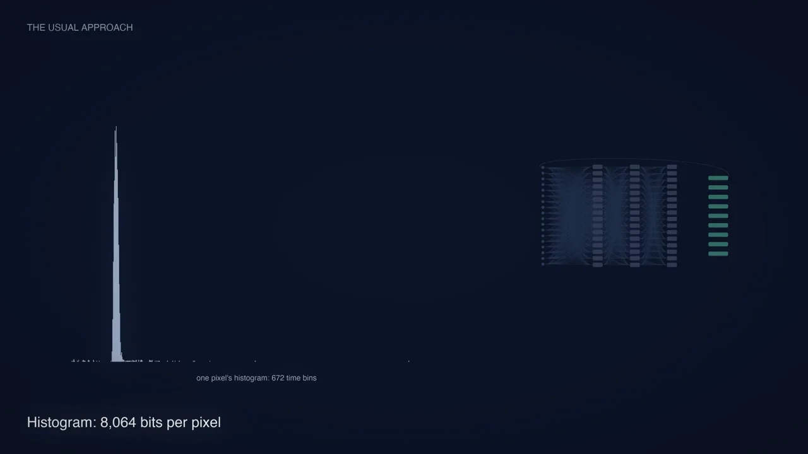

A lidar sensor sends out a short laser pulse and times how long individual photons take to
come back. Each time step is 750 ps, which is 11.2 cm of distance. The usual way to read the
sensor is to count photons into a histogram, one bin for each of the 672 possible arrival
times, and then pick the tallest bin. That takes about 8,064 bits of memory for every pixel.

This project asks whether a tiny circuit under each pixel can keep a single running distance
guess instead, updating it every time a photon arrives. It also asks whether a computer can
design that circuit from examples of right answers.

## 2. The circuit

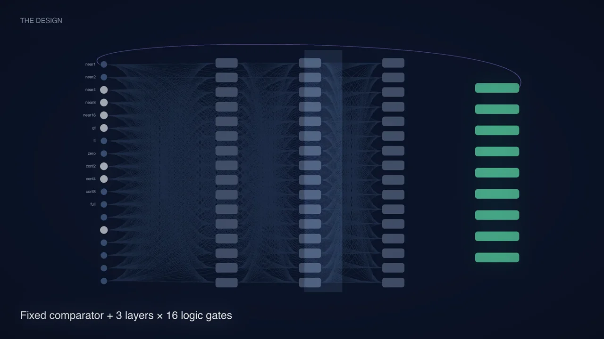

The circuit has two parts. A **fixed comparator** turns each photon into yes/no flags: is it
within 1, 2, 4, 8 or 16 steps of the guess, is it earlier or later, and how high is the
confidence count? Then **three layers of 16 logic gates** read those flags, plus 4 memory
bits, and decide what each photon does: replace the guess, move it one step later or earlier,
or raise or lower the confidence. The comparator is designed by hand. The gates are what
training finds.

## 3. How it was trained

Training has two phases.

### Phase 1: gradient training (DARTS), 1,500 steps

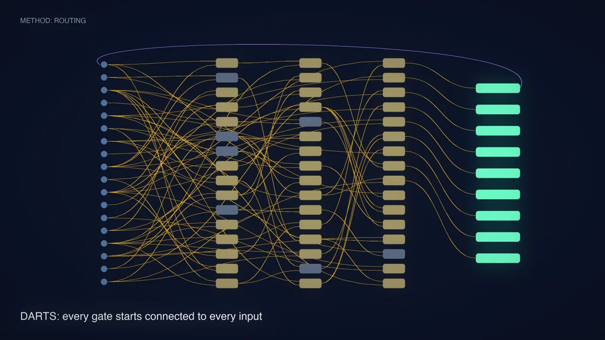

At first every gate is partly connected to every wire it could read. Each gradient step
nudges those connections toward whatever lowers the distance error, until each gate settles
on two inputs.

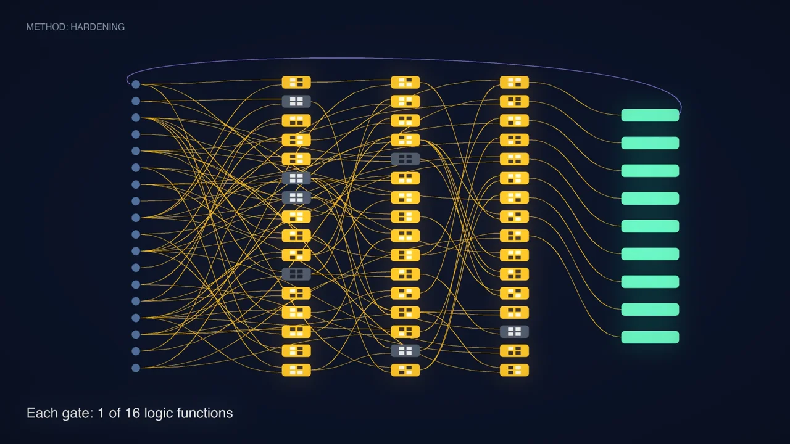

At the same time each gate starts as a blend of all 16 possible two-input logic functions.
As training goes on, a falling temperature pushes it to commit to one, which turns the network
into an ordinary circuit of real gates. From 30% of the way through (step 450), the forward
pass uses the committed gates outright while gradients still flow to the blends.

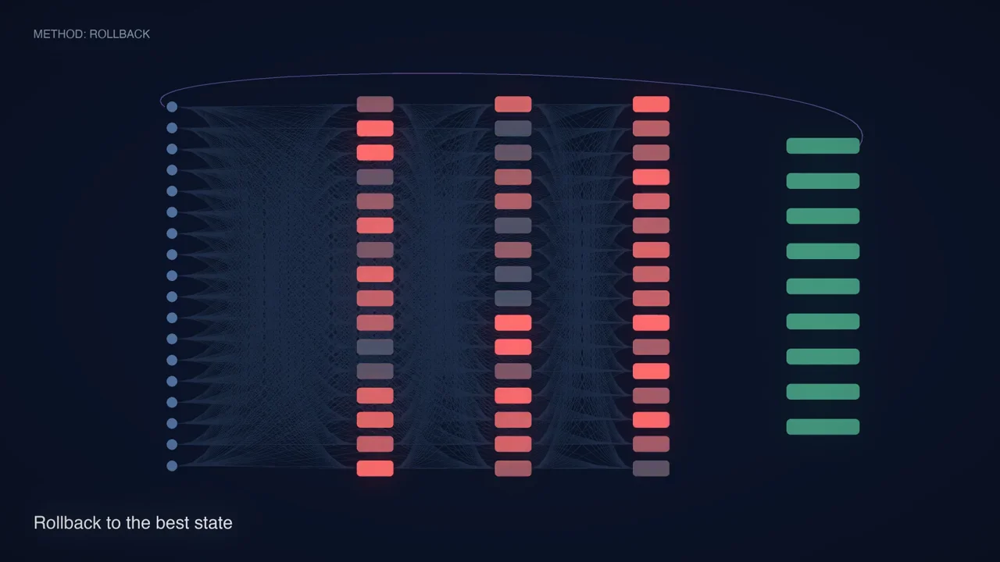

Sometimes committing makes the error suddenly much worse. When the error rises above 1.25×
the best so far, training goes back to the best version. This happened once in this run.

### Phase 2: exact search, 1,500 generations

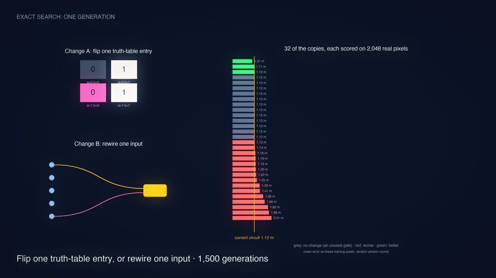

Gradient training only sees a smoothed version of the circuit, so the second phase works on
the exact circuit. Each generation makes 512 copies of the current best circuit and gives each
one or two small random changes: flip one entry of a gate's truth table, or rewire one gate
input. Each copy is scored on 2,048 real pixels, and the best one replaces the current circuit
if it is at least as good. In the generation shown, about half the changes made things worse
(red) and about a third hit unused gates and changed nothing (grey). The few that looked
better (green) might only be better on that sample of pixels. That is why the final choice is
made on separate validation pixels.

### Accuracy during training

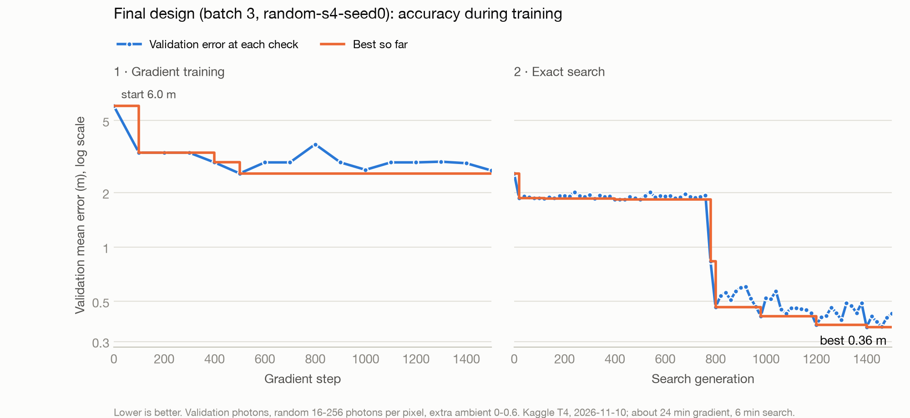

The chart tracks the validation mean error of the exact (hardened) circuit through both
phases, on a log scale. Gradient training brings it from 6.0 m to 2.55 m. The search then
holds at about 1.9 m until around generation 780, finds a change that drops it below 0.5 m,
and keeps refining to 0.36 m. Blue is the error at each check; orange is the best so far,
which is the circuit that is kept.

**Why steps and generations instead of epochs.** An epoch means one full pass through a
fixed training set, and this training has neither a fixed set nor a single kind of update:

- **The examples are new every time.** Each gradient step picks 1,024 training pixels at
  random and replays a fresh photon stream from each pixel's recorded histogram, with a random
  photon count (16-256) and a random amount of extra background light (0-0.6). The same pixel
  never gives the same example twice, so there is no point at which the data has been "seen
  once", and no epoch to count.
- **The two phases do different kinds of work.** A gradient step updates the soft connections
  and gate blends. A search generation makes no gradient update at all: it tries 512 mutated
  copies of the exact circuit and keeps the best. Neither maps onto an epoch, and their counts
  are not comparable with each other, so each phase gets its own axis.
- **These are the units the run is set and measured in.** The run is configured as 1,500
  gradient steps and 1,500 generations, and it checks validation error every 100 steps and
  every 20 generations. Those checks are the points on the chart.

## 4. Why this circuit was chosen

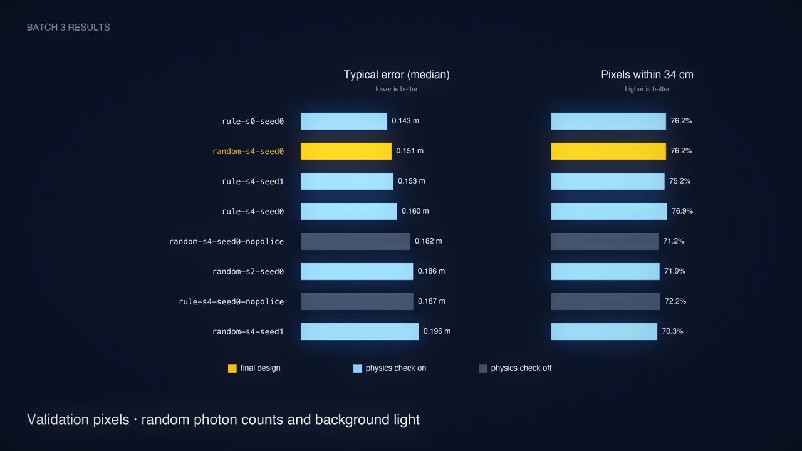

Batch 3 ran eight jobs on a Kaggle T4, about 30 minutes each. All eight produced working
circuits, scored here on the same validation pixels. This one (highlighted) reads a typical
pixel to within 15 cm, and 76% of its pixels land within 34 cm of the lidar label.

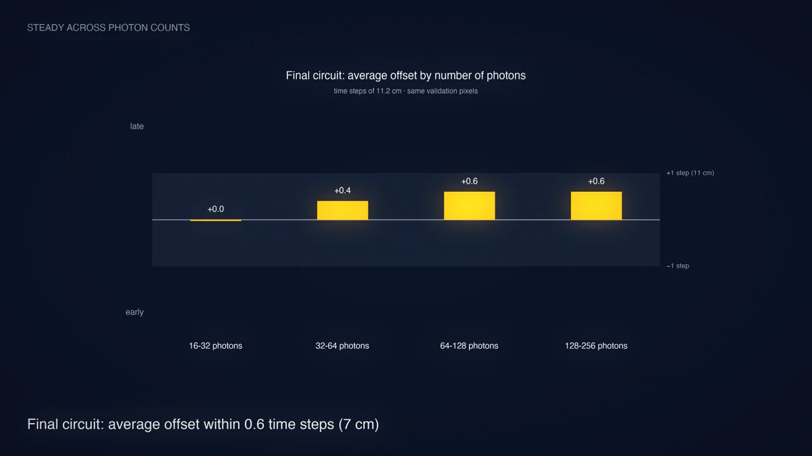

The main reason for choosing it is how steady it is. Its average offset stays within 0.6 time
steps (7 cm) from 16 photons to 256, so it does not read late in the dark and early in bright
light. The 2026-11-08 circuit random-s4-seed0-nopolice scores slightly better on error
(0.351 m mean, 0.141 m median), but its offset drifts from +1.2 to -0.6 steps with photon count.

## 5. What it learned

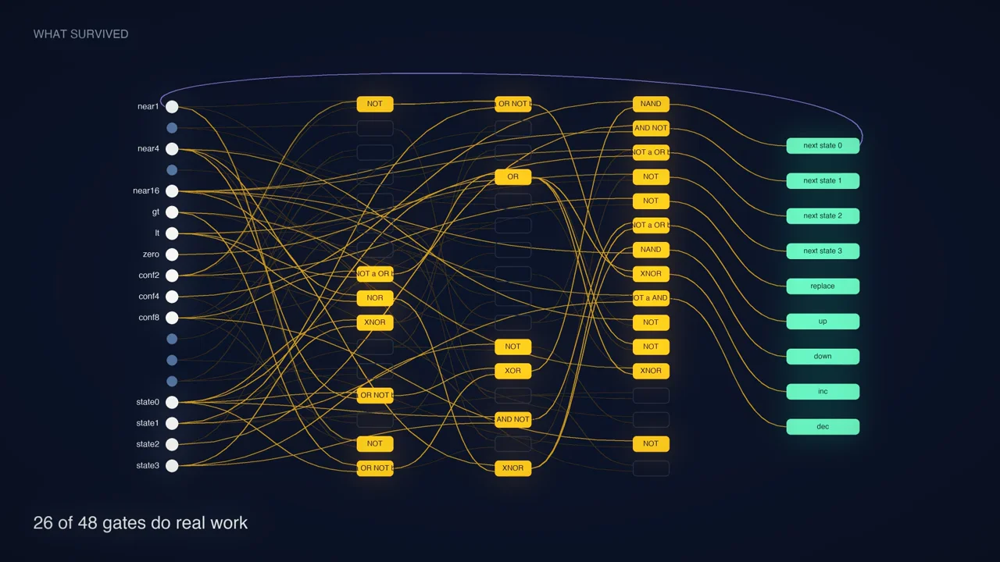

Of the 48 gates, 26 do real work, together with the 4 memory bits. The rest are constants or
unused, and synthesis removes them.

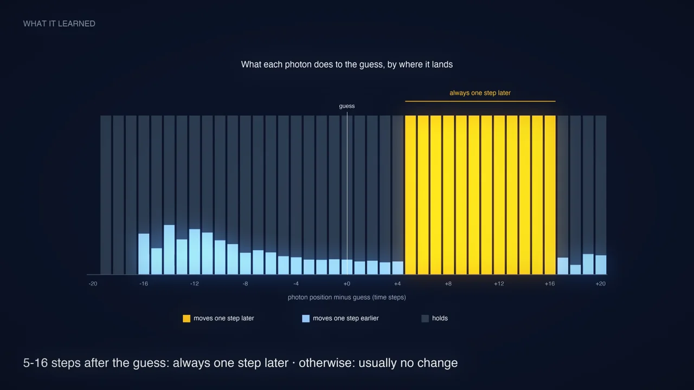

The rule it learned is simple. A photon 5-16 steps after the guess always moves it one step
later. Any other photon usually leaves it alone, and about one time in ten moves it one step
earlier, depending on the memory bits. Photons more than 16 steps earlier are ignored.

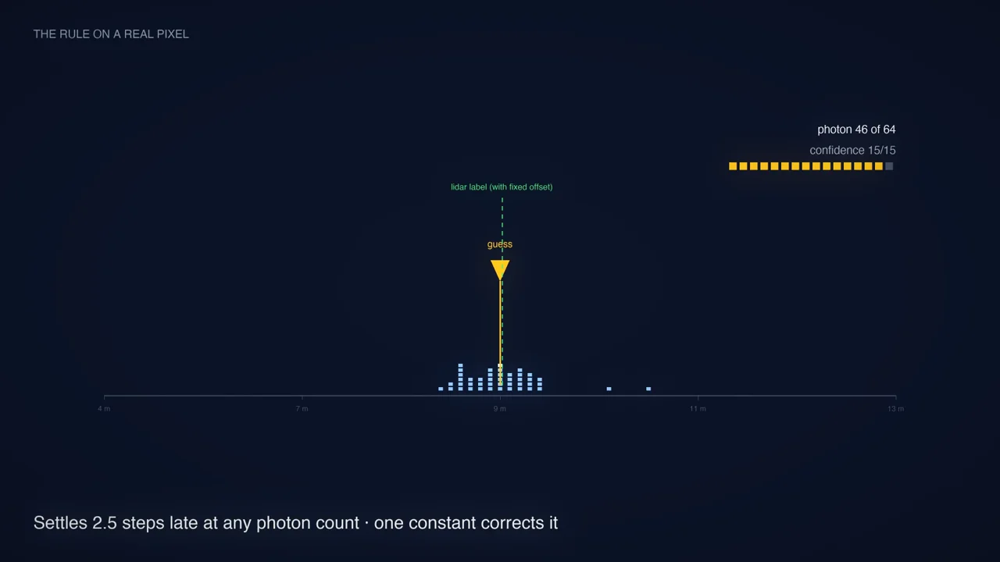

On a real pixel, the strong pull later and the weak pull earlier balance out on the returning
pulse, about 2.5 steps after the true surface. That balance point does not change with the
number of photons, so one fixed constant corrects it.

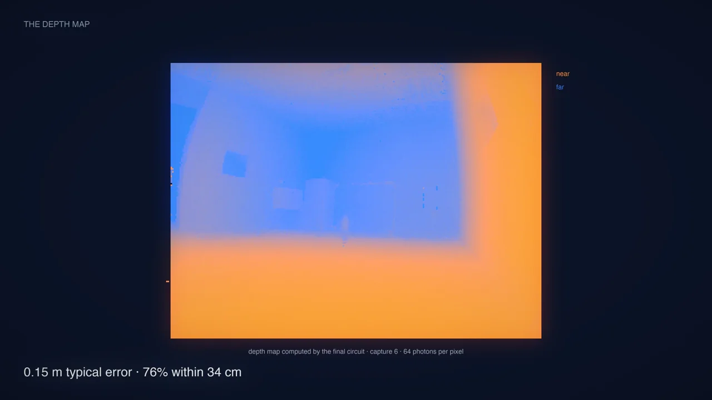

Running the circuit on every pixel of a real capture (capture 6, 64 photons per pixel) gives
this depth map.

## 6. Hardware

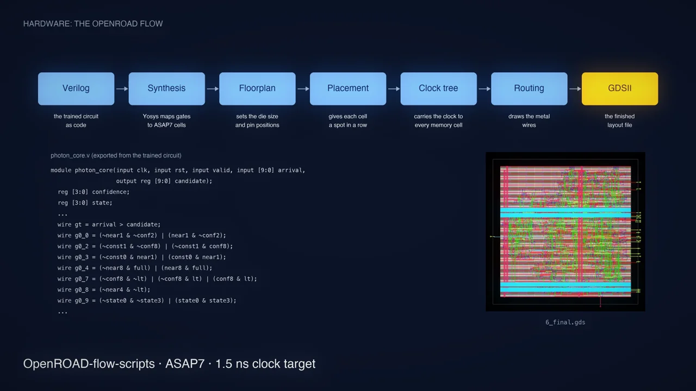

The trained circuit is exported as Verilog (`photon_core.v`) and run through OpenROAD with the
ASAP7 7 nm predictive library. Synthesis turns the Verilog into library cells, floorplanning
sets the chip area, placement gives each cell a spot, the clock tree carries the clock to every
memory cell, and routing draws the metal wires between them.

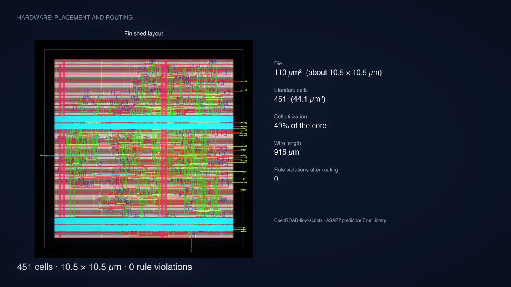

The result: 451 cells in a square about 10.5 µm on a side, connected by 916 µm of wire, with no
design-rule violations after routing.

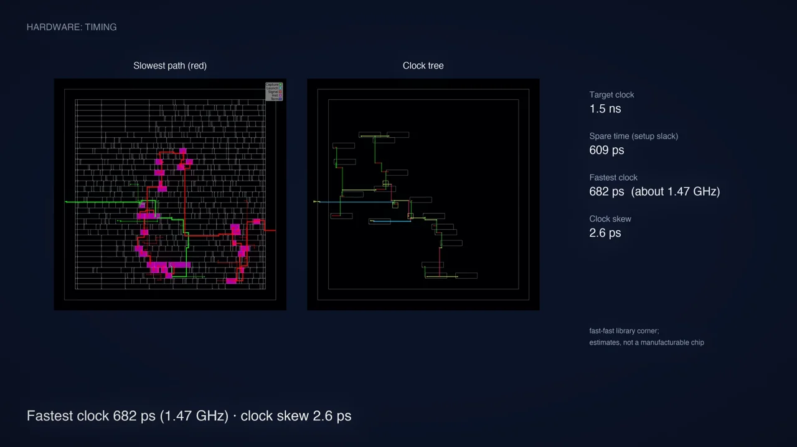

The target clock was 1.5 ns, and the design meets it with 609 ps to spare. The slowest path
(red) would allow a clock of 682 ps, about 1.47 GHz.

**Every gate in the layout:** [`gates.svg`](gates.svg) draws all 381 logic cells of the routed
netlist (`6_final.v`) with logic-gate symbols. Compound cells such as OA21, AOI221 and the
half and full adders are drawn as their internal gates inside a dashed outline. The other 70
of the 451 cells are tap cells, which have no logic. The image is large, so open it and zoom in.

## Results

On identical validation photons (random 16-256 photons, extra ambient 0-0.6): 0.363 m mean
error, 0.151 m median, 76.2% within 34 cm, and an average offset between 0.0 and +0.6 time
steps from 16 to 256 photons.

| | |
|---|---|
| Timing | Met at 1.5 ns: setup slack +609 ps, hold slack +42 ps |
| Fastest clock (post-route) | 682 ps period, about 1.47 GHz |
| Clock skew | 2.6 ps |
| Die | 110 µm² (about 10.5 x 10.5 µm) |
| Standard-cell area | 44.1 µm², 451 cells, 49% utilization |
| Wire length | 916 µm |
| Design-rule violations after routing | 0 |
| Power | 71 µW at 667 MHz, vectorless (assumed activity, not real photon streams) |

Compared with the first layout (2026-11-08 random-s4-seed1, same flow): about 6% more die
area (110 vs 104 µm²) and a faster clock (682 vs 738 ps).

## Caveats

- ASAP7 is a predictive teaching library and cannot be fabricated. The project is
  exploratory; these are realistic estimates, not a tapeout.
- ORFS uses the fast-fast library corner by default; a typical or slow corner would be slower.
- Power assumes continuous switching at 667 MHz; real photon rates are far lower. A
  gate-level simulation with real photon streams is needed for a meaningful figure.
- The routed netlist (`6_final.v`) has not yet been simulated against the Python model.
- Accuracy numbers are on validation data; the held-out test has not been run.
- The training chart uses the run's own validation photons (best 0.361 m). Re-scored on the
  shared validation photons used to compare all batches, the circuit scores 0.363 m.

## Files

`6_final.gds` (layout), `6_final.def` (placed and routed design, with net names),
`6_final.v` (routed netlist), `6_final.sdc`, `6_finish.rpt` (timing, power, area),
`5_route_drc.rpt` (empty: no DRC errors), `summary.json`, `final_*.webp` (layout, routing,
placement, worst path, clock tree, congestion), `gates.svg` (gate-level schematic; redraw with
`python asic/draw_gates.py <this folder>` from `SPAD/`), `training_accuracy.png` (validation
mean error during training, from
`runs/2026-11-10_kaggle-t4_batch3_fused-larger-search/random-s4-seed0.log`), `explainer/`
(frames from `docs/video/spad_explainer.mp4`), and the inputs `photon_core.v`,
`constraint.sdc`, `config.mk`.
