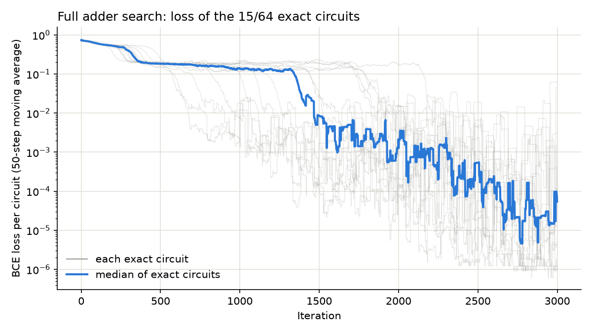

# Full Adder Discovery

Can a computer find a working circuit when given the right answers instead of
a wiring diagram? This experiment searches for a **full adder** using a supplied
set of logic gates and rules about how they may connect. The recorded results
include a correct five-gate design.

## Motivation

Every computer adds numbers using small circuits called **full adders**. A full
adder takes three bits (A, B, and a "carry in" from the previous column) and
produces two bits: the **Sum** and the **Carry out** to the next column. It is
the same "carry the one" step you learned for adding by hand, done in hardware.

Circuits like this are built from **logic gates** such as AND, OR, XOR and NOT.
Engineers normally design them by hand or with rule-based tools. This project
asks a different question: if we only tell the computer *what the right answers
are*, can it work out *which gates to use and how to wire them together*?

If it can, the same approach could later help design larger or more unusual
circuits, where the best design is not already known.

## Methodology: how it works

The program uses a technique called **DARTS** (Differentiable Architecture
Search), which is normally used to design neural networks. Here it designs
circuits instead.

1. **Empty slots for gates.** Each candidate circuit has 8 empty slots. Each
   slot will become one logic gate.
2. **Undecided choices.** At first, every slot is undecided: it is partly every
   kind of gate at once, and partly connected to every wire it could read. Each
   slot may only read the three inputs or *earlier* slots, so signals always
   flow forward and the circuit never loops back on itself.
3. **Learning from the answer sheet.** A full adder has only 8 possible input
   combinations, so the program checks the candidate against all 8 correct
   answers. After each check it nudges every choice slightly toward whatever
   reduces the mistakes. This repeats 3,000 times.
4. **Becoming decisive.** As training goes on, the program is pushed to commit,
   so each slot gradually settles on a single gate and a single pair of wires.
   A little randomness is added along the way so it can escape poor designs.
5. **Snapping to a real circuit.** At the end, each slot takes its most likely
   choice, which gives an ordinary circuit made of real gates.
6. **Checking it properly.** That final circuit is tested on all 8 input
   combinations. Only circuits that get every answer right count as a success.
   A circuit that was "almost right" during training does not count.

Because any single attempt can get stuck, the program runs **64 independent
attempts at once** and keeps the ones that succeed.

## Results

From one run of 64 attempts:

- **15 of the 64 attempts (about 1 in 4) produced a fully correct full adder.**
- All 15 had **different printed gate-and-wire descriptions**. Some may still
  be equivalent ways of expressing the same underlying design.
- **The smallest used 5 gates**, the same number as the standard textbook full
  adder. Eleven designs used 6 gates and three used 7.
- Unused slots are removed automatically, so the gate counts only include gates
  that actually affect the outputs.

The smallest circuit found, exactly as the program printed it (`n0`, `n1`, … are
the gate slots, and the last two lines say which gates produce the outputs):

```
n0 = XNOR(Cin, B)
n1 = OR(n0, A)
n2 = OR(Cin, B)
n5 = XNOR(n0, A)
n6 = AND(n2, n1)
Sum = n5
Cout = n6
```

The full list of circuits is in [results.txt](results.txt). These counts describe
that recorded run, rather than a guaranteed success rate across other runs.

### Training progress



The chart tracks a penalty for incorrect or uncertain predictions (the "loss",
lower is better), rather than a count of wrong answers. It includes only attempts
whose final extracted circuit was correct. Each faint grey line shows one
attempt's loss averaged over a moving window of 50 steps; the blue line shows
the median of those smoothed losses. The vertical axis is logarithmic: moving
from 0.1 to 0.01 means a tenfold reduction in loss. This does not mean ten times
fewer wrong answers. Progress can be uneven because training includes randomness.

## Limitations

- About three in four attempts do not end in a correct circuit, which is why
  many attempts are run together.
- A full adder is small enough to check every possible input. Larger circuits
  would need other ways to confirm they are correct.
- The program looks for *a* correct circuit. It is not told to find the smallest
  one, so the 5-gate result is found but not guaranteed.

## Running it

The program needs Python with PyTorch and Matplotlib installed. From the
repository root:

```
python full-adder-discovery/DARTS4.py
```

Runtime depends on the machine and settings. It prints the circuits it found and,
if any succeed, saves the chart to
`full-adder-discovery/figures/darts4_loss.png`. Options include `--circuits` (number of
attempts), `--nodes` (gate slots per circuit), `--steps` (training length),
`--seed` (a different random starting point) and `--noise` (amount of
randomness).
