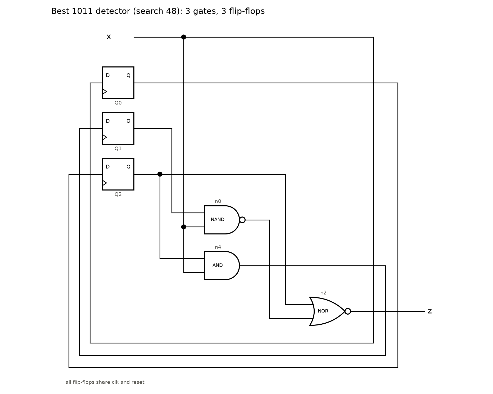
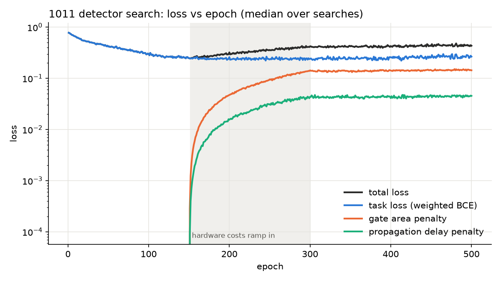

# Teaching a circuit to recognize 1011

Can a computer discover a small circuit with memory just by seeing examples?
This experiment uses [`sequential.py`](../sequential.py) to search for a circuit
that recognizes the pattern **1011** in a stream of zeros and ones.

The search receives example inputs and the correct answers. It is not given a
finished circuit or a set of rules for remembering earlier inputs.

## What the circuit does

The circuit reads one bit at a time. Whenever the four most recent bits are
`1011`, it turns its output on for that step. Otherwise, its output stays off.
Matches can overlap:

```text
Input:   1 0 1 1 0 1 1
Output:  0 0 0 1 0 0 1
```

To do this, the circuit needs memory. Its logic gates combine signals, while
small memory cells called flip-flops carry information from one step to the next.
All memory cells start at zero.

## How the search learns

The program tries 64 candidate circuits together. Each starts with room for eight
logic gates and three memory cells. During training, it adjusts which gates to
use, how to connect them, what to remember, and where to read the answer.

It learns from 256 example streams, each 16 bits long. Missing a pattern receives
a larger penalty than a false alarm, helping the search pay attention to the
relatively rare matches.

Once training is underway, the program also rewards smaller circuits and shorter
paths through their gates. These are estimates of hardware size and speed, not
measurements from a manufactured chip.

At the end, the program turns each candidate into a circuit with fixed gates and
connections. It tests the circuits on 500 new streams, each 64 bits long. It also
runs an exhaustive check: it explores every reachable combination of circuit
memory and recent input history. Passing this check proves that the circuit
recognizes the pattern correctly for input streams of any length, starting from
reset.

## What this run found

The saved run used seed 0 and 500 training rounds:

| Result | Saved run |
|---|---|
| Candidates searched | 64 |
| Circuits that passed the exhaustive check | 15 |
| Gates in the best circuit | 3 |
| Memory cells in the best circuit | 3 |
| Best circuit's accuracy on the new test streams | 100% |

The best circuit was candidate 48. Its estimated size is **17.34 gate
equivalents**, where one basic NAND gate counts as one unit and memory cells
also contribute to the total. Its longest logic path is **2 NAND-gate delays**.
These numbers describe this run and its cost model; they do not establish that
this is the smallest possible detector.

## The discovered circuit



The boxes labeled `Q0`, `Q1`, and `Q2` are memory cells. Together, they keep enough
information about earlier bits for the gates to decide whether the current bit
completes `1011`.

The interesting result is that the search discovered both the connections and
what to remember from examples alone.

## Watching the search improve



This chart shows the typical training scores across the 64 candidates. Lower
task loss means fewer mistakes. The total loss also includes penalties for
estimated circuit size and delay, so it can rise when those penalties turn on
even while the circuits continue learning.

For a closer look, download or clone this folder and open
[`loss_vs_epoch.html`](loss_vs_epoch.html) in a browser. Hover over the chart to
inspect individual training rounds, or focus it and use the arrow keys. The
chart works offline. GitHub displays the HTML source rather than running it.

## What's in this folder

| File | Purpose |
|---|---|
| [`circuit.png`](circuit.png) | Picture of the best verified circuit |
| [`loss_vs_epoch.png`](loss_vs_epoch.png) | Training chart for quick viewing |
| [`loss_vs_epoch.html`](loss_vs_epoch.html) | Interactive version of the training chart |
| [`history.json`](history.json) | Saved settings, training scores, and final circuit designs |

The program that produced these files is [`../sequential.py`](../sequential.py).

## Running the experiment

You need Python with PyTorch and Matplotlib installed. From the repository root:

```bash
python basics/sequential.py --out basics/seq_detector_out
```

This runs a new search and overwrites the generated results in this folder.
Results can vary with the seed and computing environment.

To redraw the circuit picture and interactive chart from the saved results,
without training again:

```bash
python basics/sequential.py --draw basics/seq_detector_out/history.json
```

To see the available settings:

```bash
python basics/sequential.py --help
```
